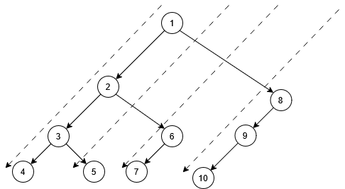
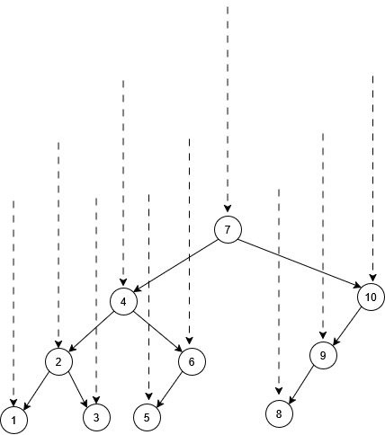
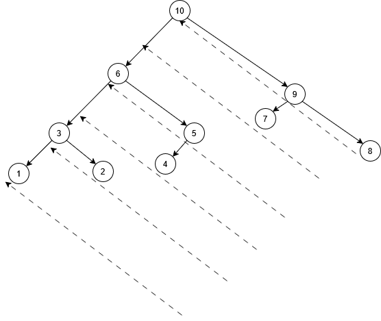

## 树

树是一个没有环的完全连通图。

### 有向树

根节点

叶子节点：度为0的节点

双亲节点（父节点，母节点，父母节点），兄弟节点和子节点

祖先节点和子孙节点

**节点的度**是这一个节点拥有的子节点个数 ，**树的度**是这一个树中所有节点的度的最大值

**节点的深度**是从根节点开始到该节点跨过的节点个数，比如根节点深度是1

子节点可以是无序的，也可以是有序的，这取决于语义


### 无向树

如果树是无向的，那么同一个树就有非常多的有向表示，比如最小生成树。


接下来默认按有向树讨论 ，因为会反复区分父节点和子节点。

至于无向树，由于不区分父节点和子节点，完全是看成是特殊的图。


### 树的路径


### 二叉树

二叉树是有向树 而且子节点有顺序

**完全二叉树 Complete Binary Tree**

只有最后一层可以是不满的，而且倒数第二层各个节点的度从左到右递减，而且度为1的节点必须是左子树

这意味着完全二叉树可以用来**标序号**


**满二叉树 Full Binary Tree**

除了叶子节点的所有节点度为2，国内叫做**正则二叉树**


**完美二叉树 Perfect Binary Tree**

所有叶子节点的深度都一样的满二叉树，注意，**国内定义的满二叉树就是完美二叉树**


#### 顺序存储 

只适用于完全二叉树

建立

1-> 2 3 -> 4 5 6 7 -> 8 9 10 11 12 13 14 15 -> ... -> 2^n to 2^{n+1}-1

查找 找双亲/孩子 O(1) 找值 O(n)

插入 中间插入 O(n) 尾部插入O(1)

删除 中间删除 O(n) 尾部删除 O(1)


#### 链式存储

二叉链表

建立

数组实现

```C
typedef struct {
    ElemType data;
    int lchild;   // 左孩子下标，-1 表示空
    int rchild;   // 右孩子下标，-1 表示空
} SBiNode;

SBiNode tree[MAXSIZE];
```

指针实现

```C
typedef struct BiTNode {
    ElemType data;
    struct BiTNode *lchild, *rchild;
} BiTNode, *BiTree;
```

插入 O(1)

查找 按值查找 O(n) 查双亲 O(n) 查孩子 O(1)

删除 


三叉链表

建立

数组实现


指针实现

```C
typedef struct TriTNode {
    ElemType data;
    struct TriTNode *lchild, *rchild, *parent;
} TriTNode, *TriTree;
```


插入 O(1)

查找 按值查找 O(n) 查双亲 O(1) 查孩子 O(1)

删除 


#### 二叉树的遍历

深度优先遍历

先序 

先访问节点，然后访问左子树，然后访问右子树



中序 

先访问左子树，中间访问节点，最后访问右子树



后序 

先访问左子树，然后访问右子树，最后访问节点



可以递归实现，也可以用一个栈来非递归实现，其中后序需要额外处理节点的右子树到底有没有被遍历


序列化和反序列化

前序+中序，中序+后序的序列化是可以反序列化的，但是前序+后序依然无法确定


##### 二叉树遍历的应用

算术表达式和表达式树之间的转换


广度优先遍历

实际上也就是层序遍历，一般使用**队列**非递归算法实现


#### 线索二叉树

子节点若为空则左边指向上一个节点 右边指向下一个遍历节点

前序线索 


中序线索 


后序线索


指针实现

```C
typedef struct ThreadNode {
    ElemType data;
    struct ThreadNode *lchild, *rchild;
    int ltag, rtag;
} ThreadNode;
```


### 多叉树


#### 顺序存储

只适用于固定的n叉完全树


#### 链式存储

**双亲表示法** 

可以使用数组实现（静态链式存储）

也可以使用链表实现（指针链式）

插入 O(1)

查找 按值查找O(n) 查双亲 O(n) 查孩子 O(1)

删除 O(1)


**孩子表示法** 

一个节点要存储全部子节点 

数组+链表实现


**双亲孩子表示法**


**孩子兄弟表示法** 

可以把任意树变成二叉树


#### 多叉树的遍历

深度优先遍历

分为前序遍历和后序遍历

树的前序遍历等价于二叉树表示的前序遍历

树的后序遍历等价于二叉树表示的中序遍历


广度优先遍历

依旧是层次遍历 使用一个队列实现


## 森林

存储方式

多个树都可以变成右子树为空的二叉树 

在右子树位置合并 这样就可以用二叉树表示一个森林


## 堆

首先是一个完全二叉树

最大堆

最小堆

二叉堆

n叉堆


拓展

可并堆

最小最大堆

对顶堆

