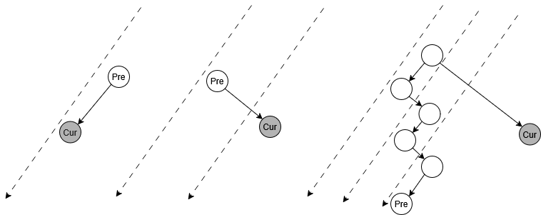
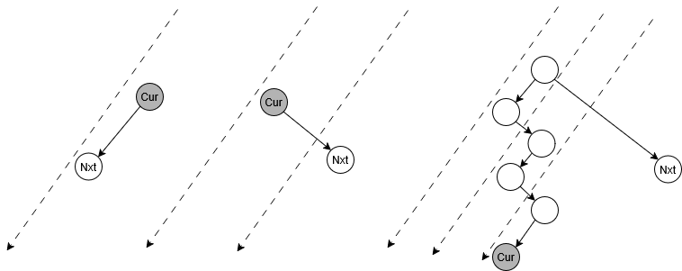
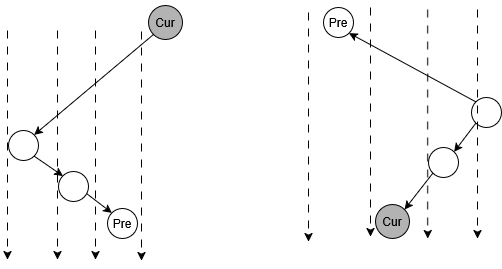
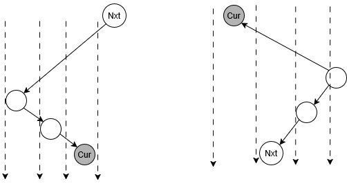
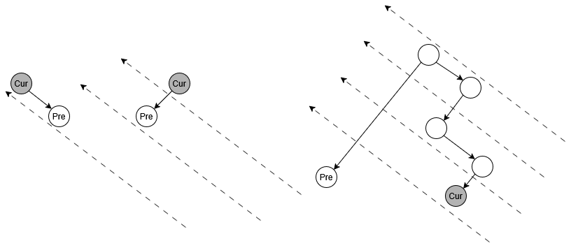
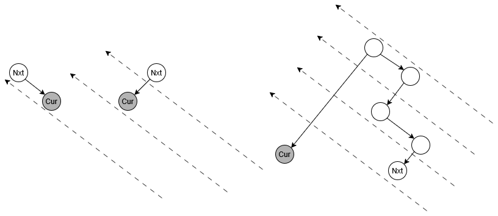

## 树

树是一个没有环的完全连通图。也就是说，一个树应该满足
$$
|E|=|V|-1
$$


### 无向树

如果树是无向的，那么同一个树就有非常多的有向表示，比如最小生成树。


### 有向树

分为**有根树**（存在唯一根）和**无根树**  一般只讨论有根树

有根树分为**内向树**（节点指向根）和**外向树**（根指向节点）

有根树还可以分为**有序树**（子节点有顺序）和**无序树**（子节点没有顺序）


**根节点**：整个树只有一个根节点

**叶子节点**：度为0的节点

**双亲节点**（父节点，母节点，父母节点）：除了根节点，每个节点有且只有一个双亲节点

**兄弟节点**：具有相同双亲节点的节点之间互为兄弟节点

**子节点**：每个节点可以有0个或多个子节点

**祖先节点**：双亲节点，双亲节点的双亲节点...构成了节点的所有祖先

**子孙节点**：子节点，子节点的子节点...构成了节点的所有子孙

**节点的度**：这一个节点拥有的子节点个数 

**树的度**：这一个树中所有节点的度的最大值。

**节点的深度**：从根节点开始到该节点跨过的节点个数，比如根节点深度是1。不同的叶子节点深度可以不同。

**节点的高度**：其所有子节点高度取最大的加上1，叶子节点的高度是1 。这意味着可能存在子节点高度是1 父母节点高度却是100的情况


### 树的路径

对于任意一个节点，从根节点到这个节点的序列就是路径 路径跨过的点的个数就是这个节点的深度


接下来默认按有向树讨论 ，因为会反复区分父节点和子节点。

至于无向树，由于不区分父节点和子节点，完全是看成是特殊的图。


### 二叉树

二叉树是有向树 而且子节点有顺序

**完全二叉树 Complete Binary Tree**

只有最后一层可以是不满的，而且倒数第二层各个节点的度从左到右递减，而且度为1的节点必须是左子树

这意味着完全二叉树可以用来**标序号**


**满二叉树 Full Binary Tree**

除了叶子节点的所有节点度为2，国内叫做**正则二叉树**


**完美二叉树 Perfect Binary Tree**

所有叶子节点的深度都一样的满二叉树，注意，**国内定义的满二叉树就是完美二叉树**


#### 顺序存储 

只适用于完全二叉树

建立

1-> 2 3 -> 4 5 6 7 -> 8 9 10 11 12 13 14 15 -> ... -> 2^n to 2^{n+1}-1

```C
ElemType tree[MAXSIZE]; //MA
```

查找 找双亲/孩子 O(1) 找值 O(n)

插入 中间插入 O(n) 尾部插入O(1)

删除 中间删除 O(n) 尾部删除 O(1)


#### 链式存储

**二叉链表**

建立

数组实现

```C
typedef struct {
    ElemType data;
    int lchild;   // 左孩子下标，-1 表示空
    int rchild;   // 右孩子下标，-1 表示空
} SBiNode;

SBiNode tree[MAXSIZE];
```

指针实现

```C
typedef struct BiTNode {
    ElemType data;
    struct BiTNode *lchild, *rchild;
}BiTNode;

BitNode* root;
```

插入 O(1)

查找 按值查找 O(n) 查双亲 O(n) 查孩子 O(1)

删除 


**三叉链表**

建立

数组实现

```C
typedef struct {
    ElemType data;
    int lchild;   /* 左孩子下标，-1 表示空 */
    int rchild;   /* 右孩子下标，-1 表示空 */
    int parent;   /* 双亲下标，-1 表示根/空 */
} STriNode;

STriNode tree[MAXSIZE];
```


指针实现

```C
typedef struct TriTNode {
    ElemType data;
    struct TriTNode *lchild, *rchild, *parent;
} TriTNode, 

TriTNode* root;
```


插入 O(1)

查找 按值查找 O(n) 查双亲 O(1) 查孩子 O(1)

删除 


#### 二叉树的遍历

**深度优先遍历**

先序 

先访问节点，然后访问左子树，然后访问右子树


中序 

先访问左子树，中间访问节点，最后访问右子树


后序 

先访问左子树，然后访问右子树，最后访问节点


可以递归实现，也可以用一个栈来非递归实现，其中后序需要额外处理节点的右子树到底有没有被遍历


**序列化和反序列化**

前序+中序，中序+后序的序列化是可以反序列化的，但是前序+后序依然无法确定


**广度优先遍历**

实际上也就是层序遍历，一般使用**队列**非递归算法实现


#### 线索二叉树 Threaded Binary Tree

如果不添加信息 那么获取某个遍历序列的前驱/后继最坏需要O(h)时间 而我们希望通过线索（本质上是预处理）加速寻找

如果左子节点若为空 则指向上一个遍历节点 

如果右子节点若为空 则指向下一个遍历节点

线索二叉树只能保证一个节点如果有线索指针 那么查询前驱/后继是O(1)

对于没有线索的节点（并不是所有节点在树线索化后都具有线索指针，因为它原来就可以有左孩子和右孩子） 寻找前驱/后继的复杂度不变


##### 前序线索树在有/没有线索下的查询

**找前序遍历的前驱的逻辑**

如果它没有父母节点，那么不存在前驱；

否则，如果它是它的父母节点的左孩子，那么前驱就是它的父母节点；

否则，如果它是它的父母节点的右孩子，那么：

- 如果它的父母节点有左孩子，那么就从左兄弟开始，如果当前节点有右孩子，往右走；否则如果当前节点有左孩子，往左走；如果当前节点左右孩子都没有，就是当前节点
- 如果它的父母节点没有左孩子（没有左兄弟），那么前驱就是它的父母节点



**找前序遍历的后继的逻辑**

如果它有左孩子，后继就是左孩子；

否则，如果它有右孩子，那么后继就是右孩子；

否则，从它开始：

- 如果当前节点有父母节点，而且当前节点是父母节点的左孩子，而且当前节点具有右兄弟，那么右兄弟就是后继，否则【当前节点没有右兄弟，或者当前节点是父母节点的右孩子】就往上走
- 如果当前节点没有父母节点，那么没有后继




##### 中序线索树在没有线索下的查询

**找中序遍历的前驱的逻辑**

如果它有左孩子，那么从它的左孩子开始：

- 如果当前节点有右孩子，那么往右走
- 如果当前节点没有右孩子，那么它的前驱就是当前节点

否则，从它开始：

- 如果当前节点有父母节点，而且当前节点是父母节点的右孩子，那么当前节点的父母节点就是前驱；如果当前节点是是父母节点的左孩子，那么向上；
- 如果当前节点没有父母节点，那么就不存在前驱




**找中序遍历的后继的逻辑**

如它有右孩子，那么从从它的右孩子开始：

- 如果当前节点有左孩子，那么往左走
- 如果当前节点没有左孩子，那么后继就是当前节点

否则，从它开始：

- 如果当前节点有父母节点，而且当前节点是父母节点的左孩子，那么当前节点的父母节点就是后继；如果当前节点是是父母节点的右孩子，那么向上；
- 如果当前节点没有父母节点，那么就不存在后继




##### 后序线索树在没有线索下的查询

**找后序遍历的前驱的逻辑**

如果它有右孩子，那么前驱就是它的右孩子；

否则，如果它有左孩子，那么前驱就是它的左孩子；

否则，从它开始：

- 如果当前节点有父母节点，而且当前节点是父母节点的右孩子，而且当前节点有左兄弟，那么左兄弟就是前驱；如果没有左兄弟，或者当前节点是父母节点的左孩子，那么向上
- 如果当前节点没有父母节点，那么不存在前驱



**找后序遍历的后继的逻辑**

如果它没有父母节点，那么不存在后继；

如果它有父母节点，而且它是它父母节点的右孩子，那么它的父母节点就是后继；

如果它是它父母节点的左孩子，而且它没有右兄弟，那么它的父母节点就是后继；

如果它是它父母节点的左孩子，而且它有右兄弟，那么从它的右兄弟开始：

- 如果当前节点有左孩子，那么往左
- 否则，如果当前节点有右孩子，那么往右
- 如果当前节点左右孩子都没有，那么当前节点就是后继




如果已经有线索了，那么

**1.对于有左右孩子的节点**

按前面的逻辑寻找前驱和后继

**2.对于只有左孩子的节点**

按前面的逻辑寻找前驱

此时这个节点的右指针应该指向后继

**3.对于只有右孩子的节点**

此时左指针应该指向前驱节点

按前面的逻辑寻找后继

**4.对于叶子节点**

此时左指针应该指向前驱节点  右指针应该指向后继节点


如果线索二叉树没有父节点指针，那么

**1.对于有左右孩子的节点**

按前面的逻辑，目标是只有在**前序前驱**和**后序后继**的时候是必须访问父母节点的，所以前序前驱和后序后继在无线索时无法寻找

**2.对于只有左孩子的节点**

按前面的逻辑，目标是只有在前序前驱是必须访问父母节点的，所以前序前驱无法寻找，中序/后序前驱可以

一定可以通过线索寻找到后继

**3.对于只有右孩子的节点**

一定可以通过线索寻找到前驱

按前面的逻辑，目标是只有在后序后驱是必须访问父母节点的，所以后序后驱无法寻找，前序/中序后驱可以

**4.对于叶子节点**

一定可以通过线索寻找到前驱和后继


线索二叉树的实现

新添加ltag/rtag 用0表示结点孩子，用1表示结点前驱

数组实现

```C
typedef struct {
    ElemType data;          // 数据域
    int      lchild;        // 左孩子下标 / 左线索指向的前驱下标
    int      rchild;        // 右孩子下标 / 右线索指向的后继下标
    int      ltag;          // 0: lchild 是左孩子   1: lchild 是前驱线索
    int      rtag;          // 0: rchild 是右孩子   1: rchild 是后继线索
} ThreadNode;
```

指针实现

```C
typedef struct ThreadNode {
    ElemType data;
    struct ThreadNode *lchild, *rchild;
    int ltag, rtag;
} ThreadNode;
```


线索二叉树的建立


### 多叉树


#### 顺序存储

只适用于固定的n叉完全树


#### 链式存储

**双亲表示法** 

可以使用数组实现（静态链式存储）

也可以使用链表实现（指针链式）

插入 O(1)

查找 按值查找O(n) 查双亲 O(n) 查孩子 O(1)

删除 O(1)


**孩子表示法** 

一个节点要存储全部子节点 

数组+链表实现


**双亲孩子表示法**

数组中每个数配套一个链表


**孩子兄弟表示法** 

左指针指向第一个左孩子，右指针指向第一个右兄弟

可以把任意树变成二叉树


#### 多叉树的遍历

**深度优先遍历**

分为前序遍历和后序遍历

树的**前序遍历**等价于二叉树表示的**前序遍历**

树的**后序遍历**等价于二叉树表示的**中序遍历**


**广度优先遍历**

依旧是层次遍历 使用一个队列实现


## 森林

存储方式

多个树都可以变成右子树为空的二叉树 

在右子树位置合并 这样就可以用二叉树表示一个森林


## 堆

首先是一个**完全二叉树**

最大堆


最小堆


二叉堆

使用二叉树实现的堆


n叉堆

使用n叉树实现的堆


**上浮和下沉**


**插入**

放在最后一个节点，然后上浮


**删除**

与最后的节点交换位置 删除最后节点 然后下沉


#### 拓展

可并堆

最小最大堆

对顶堆

