考虑到查找有非常多的分类方式，比如

精确查找和模糊查找

内部查找/外部查找（比较次数vsIO次数）

静态查找/动态查找（查找中混合更新）

单次查找/多次查找（多次在线 多次离线）

基于比较/直接寻址（序/哈希）

带索引/不带索引

在集合/线性表/树/图上的查找

这里就按精确查找和模糊查找分类，因为两者是根本不同的范式。


## 精确查找

是否存在值等于特定值的元素

### 内部查找

#### 静态查找

##### 顺序查找

适用于任意数组，$O(n)$


##### 二分查找

只适用于有序数组，$O(\log n) $理论上N分查找最优就是N=2

二分查找的实现是非常细节的，包括中点计算，终止条件，更新条件

首先要保证不会死循环，所以终止条件和更新条件需要写好

其次要考虑返回的是什么：任意值等于target的下标？从左到右第一个值等于target的下标？从左到右最后一个值等于target的下标？

下面只假设数组是升序的，避免重复


**区间表示与循环条件**

循环条件只和区间表示有关

如果你是在$[l,r]$上查询 那么就是

```C
while(l <= r){ ... }
```

如果你是在$[l,r)$或者$(l,r]$上查询 那么就是

```C
while(l < r){ ... }
```

如果你是在$(l,r)$上查询 那么就是

```C
while(l < r - 1){ ... }
```


**中点计算和选择**

由于不是所有区间长度len都是2n，所以中点分为左中点和右中点，也就是说

如果$len=2n$ 那么左中点是n 右中点是n+1

如果$len=2n+1$ 那么左中点和右中点就必须都是n+1

左中点：

```C
int mid=(l+h)/2;
// or
int mid=l+(h-l)/2;
```

右中点：

```C
int mid=(l+h+1)/2;
// or
int mid=l+(h-l+1)/2;
```

这里的除法是**向下取整**

但是C/C++的/是向零取整，需要特别小心，如果使用向零取整，(l+h)/2和(l+h+1)/2会偏离语义

一般默认下标都是自然数，所以问题不大，或者实在担心可以使用l+(h-l)/2或者l+(h-l+1)/2


如果是$[l,r)$ 那么必须使用左中点 因为右中点可能取到r

如果是$(l,r]$ 那么必须使用右中点 因为左中点可能取到l

$(l,r)$和$[l,r]$取哪个都可以 因为全闭区间包含端点 全开区间 len>=2中点不可能是端点


**更新和返回条件**

需要确定需求，再选择更新条件，而更新条件必须根据边界开闭来 

- 闭边界就必须去掉端点 
- 开边界就必须不能去掉

为什么？

因为闭边界不去掉端点可能死循环

比如使用左中点的闭区间 [0,1] d[0]=1 d[1]=2 寻找2 如果不去掉 mid就永远指向1 `l=mid` 永远指向1  陷入死循环

而开区间如果去掉反而会遗漏答案

比如使用左中点的右开区间 [0,2) d[0]=2 d[1]=3 d[2]=3  寻找2 如果去掉端点mid指向1  `r=mid-1`变成[0,0) 此时直接结束查询

返回条件根据需求

如果是任意的那么直接返回 

如果要求第一个出现的 那么就需要临时记入当前记载的最早出现的ans 然后更新右边界 看有没有更早出现的target

如果要最后一个出现的 那么就需要临时记入当前记载的最晚出现的ans 然后更新左边界 看有没有更晚出现的target


1.返回任意值等于target的下标

`d[mid] < target`  ：需要更新左边界 如果左边界是闭的 必须使用`l=mid+1` 如果左边界是开的 必须使用`l=mid`  

`d[mid] > target`  ：需要更新右边界 如果右边界是闭的 必须使用`r=mid-1` 如果右边界是开的 必须使用`r=mid` 

`d[mid]==target`：直接返回


以闭区间 `[l,r]` 为例：

```C
int l = 0, r = n - 1;

while (l <= r) {
    int mid = l + (r - l) / 2;

    if (d[mid] == target) {
        return mid;
    } else if (d[mid] < target) {
        l = mid + 1;      // 去右边，左闭跨过 mid
    } else {
        r = mid - 1;      // 去左边，右闭跨过 mid
    }
}
return -1;
```


2.从左到右第一个值等于target的下标

`d[mid] < target`  ：需要更新左边界 

`d[mid] > target`  ：需要更新右边界

`d[mid]==target`：记入ans=mid 需要去左边继续找，更新右边界

以闭区间 `[l,r]` 为例：

```C
int l = 0, r = n - 1;
int ans = -1;

while (l <= r) {
    int mid = l + (r - l) / 2;

    if (d[mid] == target) {
        ans = mid;        // 记录当前答案
        r = mid - 1;      // 去左边找更早的，右闭跨过 mid
    } else if (d[mid] < target) {
        l = mid + 1;      // 去右边，左闭跨过 mid
    } else {
        r = mid - 1;      // 去左边，右闭跨过 mid
    }
}
return ans;
```


3.从左到右最后一个值等于target的下标

`d[mid] < target`  ：需要更新左边界 

`d[mid] > target`  ：需要更新右边界

`d[mid]==target`：记入ans=mid 需要去右边继续找，更新左边界

以闭区间 `[l,r]` 为例：

```C
int l = 0, r = n - 1;
int ans = -1;

while (l <= r) {
    int mid = l + (r - l) / 2;

    if (d[mid] == target) {
        ans = mid;        // 记录当前答案
        l = mid + 1;      // 去右边找更晚的，左闭跨过 mid
    } else if (d[mid] < target) {
        l = mid + 1;      // 去右边，左闭跨过 mid
    } else {
        r = mid - 1;      // 去左边，右闭跨过 mid
    }
}
return ans;
```


##### 三分查找

二分查找适用于局部单调求零点，三分查找而适用于求局部单峰极值，也就是序列呈现递增-递减或递减-递增的状态

...

三分查找可以优化为**斐波那契查找**


##### 分块索引查找

要求数组块间有序、块内无序，这种情况一般都是通过桶排序来初始化 最好是把块分为$\sqrt{n}$大小

用一个索引表记入每个块的初始位置 以及这个块的最大值作为关键字

（要求下一个块的最小值一定大于等于这个块的最大值）

搜索：先二分搜索target在哪个块 然后块内顺序查找


##### 静态二叉搜索树查找

如果概率相同，那么最优的查找树就是后面要谈的平衡二叉树

如果概率不同，那么最优的查找树就需要通过动态规划构造，次优的查找树可以通过选择一个划分使得左右概率和尽量相同来实现。


#### 动态查找

##### 分块链表查找

基于分块索引查找的思想建立索引表，但是要求每个块是独立的，用链表维护

插入：如果块大于$2B$ 需要分裂 $O(\sqrt{n})$

删除：如果块小于$\frac{1}{2} B$ 需要合并 $O(\sqrt{n})$


##### 跳表查找

...


##### 二叉搜索树查找

二叉搜索树要求对于任意子树，左子树的值严格小于根节点，右子树的值严格大于根节点 也叫**二叉排序树**

这意味着标准的二叉搜索树要求值不重复（重复的时候需要额外规定是统一往左子树插入还是右子树插入）

普通二叉搜索树

插入：插入为叶子节点 最坏$O( n)$ 

删除：是叶子节点就直接删除；非叶子节点，寻找左侧最大/右侧最小，交换，删除 最坏$O( n)$ 


二叉平衡树

普通二叉搜索树的优化 避免最坏$O( n)$ 通过维护高度差不超过阈值来实现平衡 达到 $O(\log n)$

基础的平衡操作就是旋转

左旋

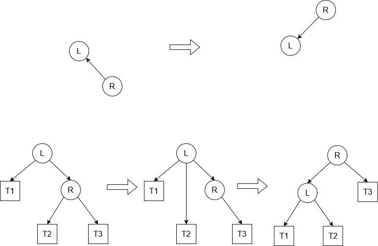


右旋

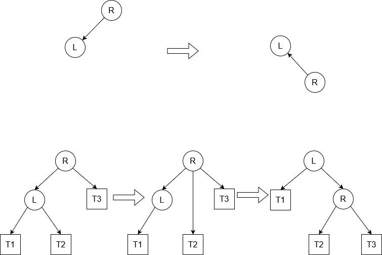


基于高度差平衡 -- AVL树

记入左右子树的高度差 插入和删除需要维持所有节点的高度差不能超过1  否则就需要平衡操作 

AVL树的失衡情况：

LL

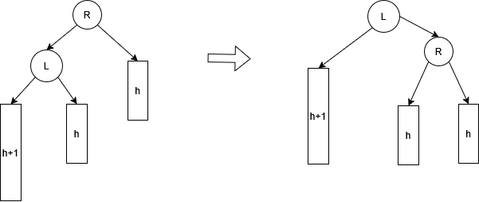

LR

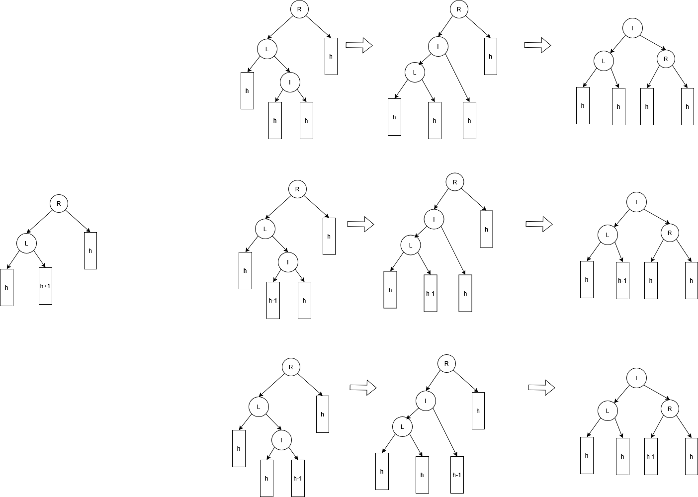

RL

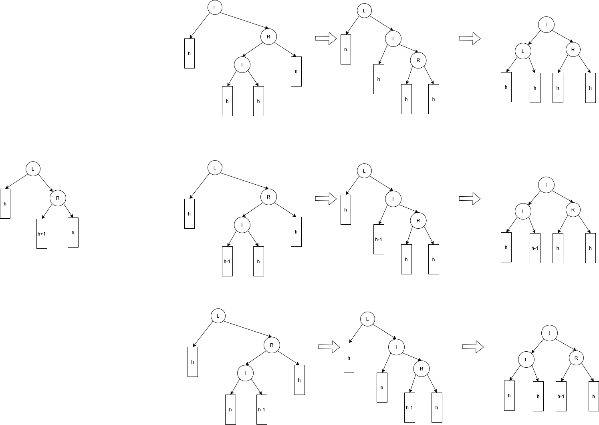


RR

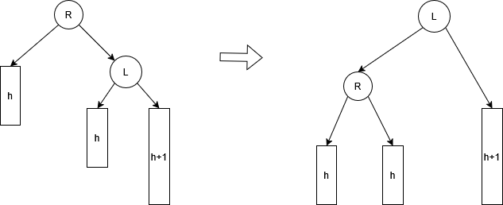


基于节点大小比例的平衡 -- Size Balanced Tree

size(LL)≤size(R)

size(LR)≤size(R)

size(RL)≤size(L)

size(RR)≤size(L)


基于节点大小关系的平衡 -- Weight  Balanced Tree

L+R+1≤αL,αR


伸展树 Splay Tree

旋转只在访问的时候触发，使用zig-zig和zig-zag来压缩路径，通过摊还分析保证平均查找是$O(\log n)$


替罪羊树 Scapegoat Tree

发生失衡时，直接对子树进行重构，通过摊还分析保证平均查找是$O(\log n)$


红黑树与左偏红黑树

红黑树本质是2-3-4树


左偏红黑树认为是红黑树的优化，本质是2-3 B树


AA树本质就是2-3 B树的带水平箭头的二叉树实现，后面会讲。


##### K-D树查找


#### 哈希表查找

与之前的方法不同，哈希表是不基于比较的查找，支持动态。


### 外部查找

B 树 / B+ 树

B 树的本质就是平衡的**多叉搜索树**，而且可以保证所有的叶子节点高度都相同，这是平衡二叉树做不到的

与普通的多叉树不同 B树中的节点不仅仅只有一个关键字 而是多个关键字 我们先定义N阶节点：

- **N阶节点有N个孩子，存储存储N-1个关键字**

我们将在普通的树箭头的表示上，添加水平箭头来描述N阶节点


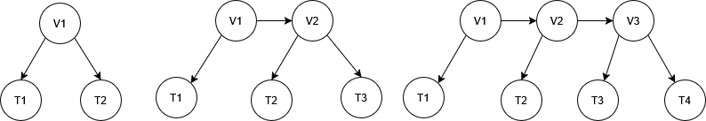


这是2 3 4阶节点的例子 很容易推广到N阶 

我们定义$m$阶B树的所有节点需要满足下面的前提：

- **所有节点的阶数最高是$m$**

这只是定义而已，为了维持平衡，需要额外的条件：

- **除了根节点，其他节点的阶数必须至少是$\lceil\frac{m}{2}\rceil$**（叶子节点的空孩子也算作孩子，但是不算节点）

可以用阶的上下限来描述B树 所以3阶B树也叫**2-3树** 4阶B树也叫**2-3-4树**


B树维持平衡的操作就是分裂与合并

分裂

如果当前节点阶数c超过了最高阶，应该立即分裂，用于插入后失衡

当c=2n的时候，c+1阶节点会分裂为n阶节点和n+1阶节点 当c=2n+1的时候，c+1阶节点会分裂为2个n+1阶节点

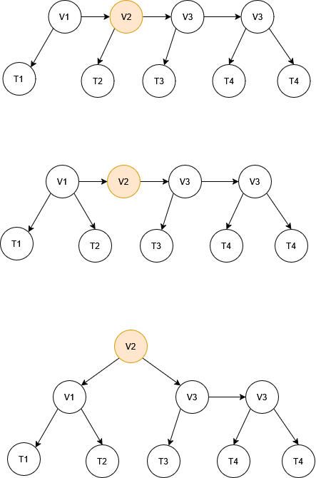


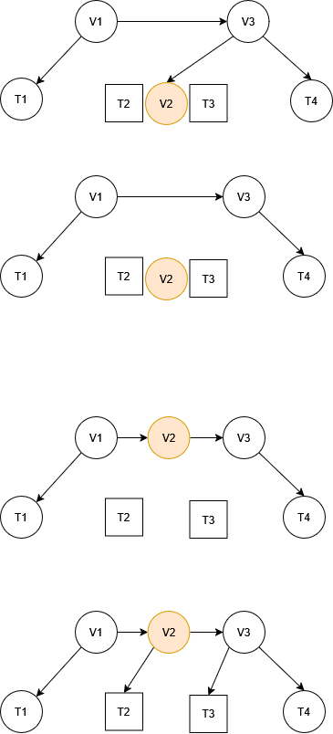


合并

合并就是分裂的逆过程，节点阶如果小于$\lceil\frac{m}{2}\rceil$，应立即合并，用于处理删除后失衡。

合并的关键在于，它会把自己的父母节点的一个关键字拉下来，而不是两个B子树单独合并

比如T2 T3合并 需要把V2拉下来

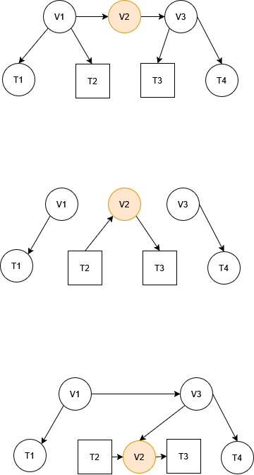


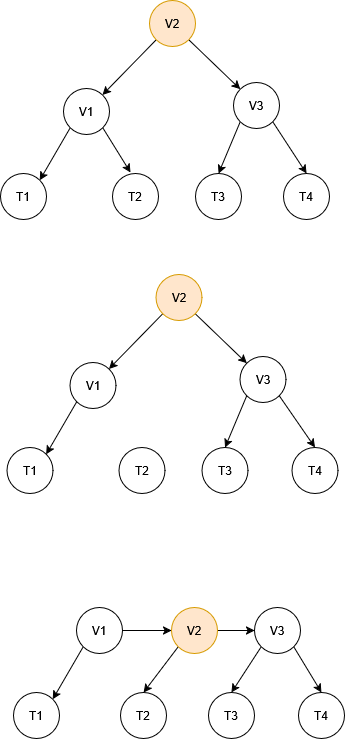


从这里我们也可以看出来，合并是需要父节点的，所以合并只可能在非根节点上发生。


插入

插入就是直接插入到叶子节点，然后自底向上触发分裂


删除

删除要和叶子节点交换 然后删除叶子

此时叶子节点阶可能小于$\lceil\frac{m}{2}\rceil$，立即与左侧/右侧的兄弟节点合并，这里就有趣了：

你合并后的子节点可能超过m （但是绝对不可能超过2m 因为兄弟节点阶最多m 而你是$\lceil\frac{m}{2}\rceil-1$ ）

这种情况下需要分情况讨论

- 这个子节点阶确实超过m 需要立即触发一次分裂 此时父节点的阶不变 无需继续

- 这个子节点阶没有超过m 而父阶的阶却少于$\lceil\frac{m}{2}\rceil$ 这个时候视角转向父节点和其他节点合并 也就是向上触发合并
- 这个子节点阶没有超过m 而父阶的阶也没有少于$\lceil\frac{m}{2}\rceil$  此时无需继续


借位

子节点的 合并+立即分裂 效率太低了，我们可以把这个操作结合为借位操作

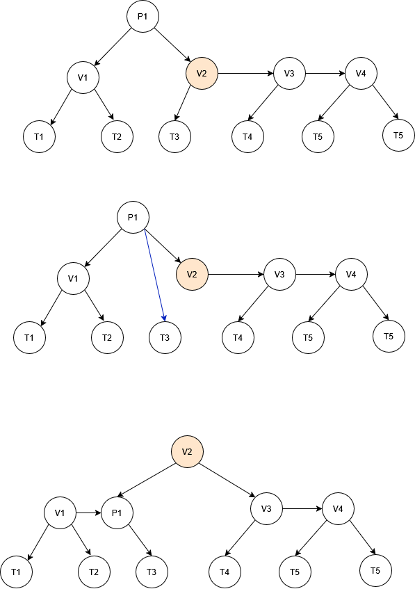


这其实就等价于一次合并加分裂

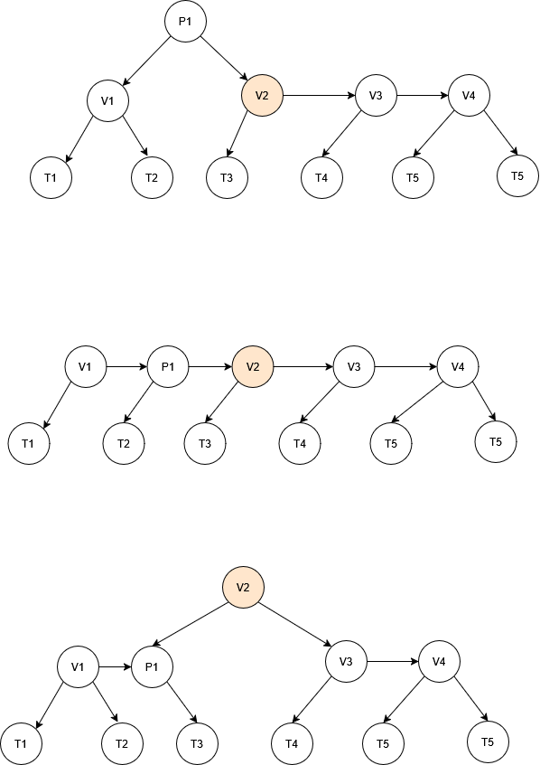


为什么B树用于外部查找？因为B树把节点做成一个页大小，极其有效的压低了树高，磁盘IO次数会极大减少。


R 树 / R+ 树

B树的高维版，用于处理高维数据

