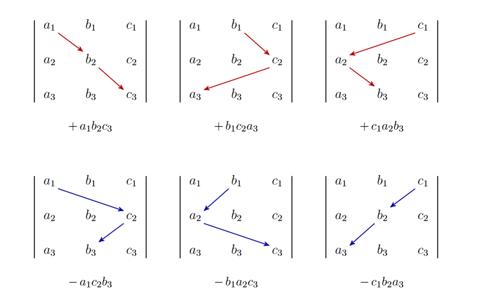
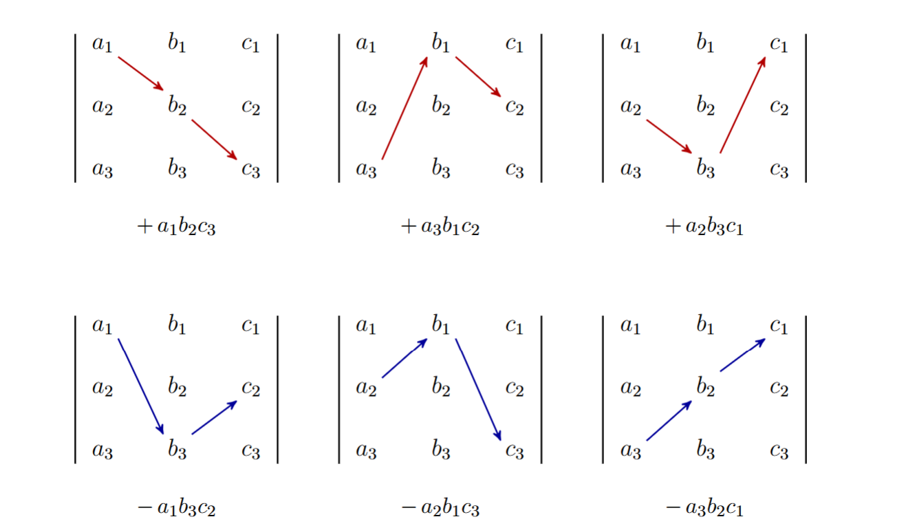

## 基础定义

设A是一个$F^{n \times n}$的矩阵，那么它的行列式记为$det(A)$或者$|A|$

### 外积定义

n个向量按顺序描述了一个n维空间的有向平行体，所谓外积（wedge product）就是这个n维平行体的有向体积。具体来说，设 $A$ 是 $n$ 阶方阵，把它的行（或列）看成向量 $\mathbf v_1,\mathbf v_2,\dots,\mathbf v_n$，那么

$$
\mathbf v_1\wedge \mathbf v_2\wedge\cdots\wedge \mathbf v_n=\det(A)\;\mathbf e_1\wedge \mathbf e_2\wedge\cdots\wedge \mathbf e_n
$$
外积的三条运算规则：

**双线性**（可分配、可提系数）

$(a\mathbf u+b\mathbf v)\wedge\mathbf w=a\,\mathbf u\wedge\mathbf w+b\,\mathbf v\wedge\mathbf w$ 

$\mathbf w \wedge (a\mathbf u+b\mathbf v)=\mathbf w \wedge a\,\mathbf u+b\,\mathbf w \wedge \mathbf v$ 

全对角为1，其他都是0矩阵的行列式值为1

**反对称**（交换变号）

$\mathbf u\wedge\mathbf v=-\,\mathbf v\wedge\mathbf u$

一个行列式内部两行交换，改变变行列式符号

**幂零性**（自外积为零）

  $\mathbf e_i\wedge\mathbf e_i=0$

意味着矩阵如果线性相关，那么外积为0

2 阶例子

计算$D=\begin{vmatrix} a & b\\ c& d\end{vmatrix}$

**第 1 步：写成两个向量**

$$
\begin{cases}
\mathbf v_1=a\mathbf e_1+b\mathbf e_2\\
\mathbf v_2=c\mathbf e_1+d\mathbf e_2
\end{cases}
$$

**第 2 步：计算**
$$
(a\mathbf e_1+b\mathbf e_2)\wedge(c\mathbf e_1+d\mathbf e_2)
=ad\,\mathbf e_1\wedge\mathbf e_2+bc\,\mathbf e_2\wedge\mathbf e_1
=(ad-bc)\,\mathbf e_1\wedge\mathbf e_2
$$

3 阶例子

计算$D=\begin{vmatrix} 1&2&3\\ 0&1&4\\ 5&6&0\end{vmatrix}$

**第 1 步：写成三个向量**
$$
\begin{cases}
\mathbf v_1=\mathbf e_1+2\mathbf e_2+3\mathbf e_3 \\
\mathbf v_2=\mathbf e_2+4\mathbf e_3\\
\mathbf v_3=5\mathbf e_1+6\mathbf e_2
\end{cases}
$$

**第 2 步：计算**
$$
\begin{aligned}
\mathbf v_1\wedge\mathbf v_2
&=(\mathbf e_1+2\mathbf e_2+3\mathbf e_3)\wedge(\mathbf e_2+4\mathbf e_3)
\newline
&=\mathbf e_1\wedge\mathbf e_2+4\mathbf e_1\wedge\mathbf e_3
+8\,\mathbf e_2\wedge\mathbf e_3
+3\,\mathbf e_3\wedge\mathbf e_2
\newline
&=\mathbf e_1\wedge\mathbf e_2+4\,\mathbf e_1\wedge\mathbf e_3+5\,\mathbf e_2\wedge\mathbf e_3
\end{aligned}
$$

$$
\begin{aligned}
(\mathbf v_1\wedge\mathbf v_2)\wedge\mathbf v_3 
&=(\mathbf e_1\wedge\mathbf e_2+4\,\mathbf e_1\wedge\mathbf e_3+5\,\mathbf e_2\wedge\mathbf e_3)\wedge(5\mathbf e_1+6\mathbf e_2)
\newline
&=4\,\mathbf e_1\wedge\mathbf e_3\wedge(5\mathbf e_1+6\mathbf e_2)+5\,\mathbf e_2\wedge\mathbf e_3\wedge(5\mathbf e_1+6\mathbf e_2)
\newline
&=24\cdot(-1)\cdot \mathbf e_1\wedge\mathbf e_2\wedge\mathbf e_3+25\cdot \mathbf e_1\wedge\mathbf e_2\wedge\mathbf e_3=1\cdot\mathbf e_1\wedge\mathbf e_2\wedge\mathbf e_3
\end{aligned}
$$

### 组合定义

$$
det(A)=\sum \sigma(p)a_{1p_1}a_{2p_2}...a_{np_n}
$$

其中$(p_1,p_2,...,p_n)$是$(1,2,...,n)$的排列，$\sigma(p)$表示把$(p_1,p_2,...,p_n)$通过两两置换变成$(1,2,...,n)$的次数。

我们知道两两置换变成标准序的路径有无数种，但是所有路径的交换次数必须同奇偶，这是置换群的结论。

特别地，记这个排列经过交换后得到标准排列的最少交换次数叫做这个排列的**逆序数**

这个计算公式就是计算行列式的**萊布尼茲公式**leibniz formula，事实上没有人会真的用这个算，每个排列都算逆序数计算量太大了。

$$
\begin{vmatrix}a_1 & b_1 & c_1 \\ a_2 & b_2 & c_2 \\ a_3 & b_3 & c_3\end{vmatrix}= +a_1b_2c_3+b_1c_2a_3+c_1a_2b_3-a_1c_2b_3-b_1a_2c_3-c_1b_2a_3
$$

按垂直方向选择

按水平方向选择

### 递归定义

余子式（minor）

是相对于矩阵的一个元素而言的,使用$M_{ij}$表示n阶矩阵删除第i行和第j列后得到的**n-1阶矩阵对应的行列式**

代数余子式（cofactor）

**带符号的余子式**$A_{ij}=(-1)^{i+j}M_{ij}$就是代数余子式

固定i，有
$$
|A|=\sum_{j=1}^{n} a_{ij}A_{ij}
$$
固定j，有
$$
|A|=\sum_{i=1}^{n} a_{ij}A_{ij}
$$
这个计算公式就是计算行列式的**拉普拉斯公式**Laplace formula

事实上，拉普拉斯展开不仅仅只针对1阶子式展开（上面的系数$a_{ij}$就是1阶子式），还可以针对k阶子式 记
$$
D\begin{pmatrix}i_1,\dots,i_k\\ j_1,\dots,j_k\end{pmatrix}
$$
表示取第 $i_1,\dots,i_k$行、第 $j_1,\dots,j_k$列得到的$k$阶子式的行列式,那么

$$
|A|=\sum_{1\le j_1<\cdots<j_k\le n}
(-1)^{i_1+\cdots+i_k+j_1+\cdots+j_k}
D\begin{pmatrix}i_1,\dots,i_k\\ j_1,\dots,j_k\end{pmatrix}
D\begin{pmatrix}\text{剩余行}\\ \text{剩余列}\end{pmatrix}
$$

比如设四阶行列式

$$
D=
\begin{vmatrix}
a_{11}&a_{12}&a_{13}&a_{14}\\
a_{21}&a_{22}&a_{23}&a_{24}\\
a_{31}&a_{32}&a_{33}&a_{34}\\
a_{41}&a_{42}&a_{43}&a_{44}
\end{vmatrix}
$$

若按第$1,2$行作$k=2$展开，则公式为

$$
D=\sum_{1\le j_1<j_2\le 4}
(-1)^{1+2+j_1+j_2}
\begin{vmatrix}
a_{1j_1}&a_{1j_2}\\
a_{2j_1}&a_{2j_2}
\end{vmatrix}
\begin{vmatrix}
a_{3k_1}&a_{3k_2}\\
a_{4k_1}&a_{4k_2}
\end{vmatrix}
$$

其中 $k_1<k_2$是去掉 $j_1,j_2$后剩下的两列。完整展开为

$$
\begin{aligned}
D={}&
\begin{vmatrix}
a_{11}&a_{12}\\
a_{21}&a_{22}
\end{vmatrix}
\begin{vmatrix}
a_{33}&a_{34}\\
a_{43}&a_{44}
\end{vmatrix}
-
\begin{vmatrix}
a_{11}&a_{13}\\
a_{21}&a_{23}
\end{vmatrix}
\begin{vmatrix}
a_{32}&a_{34}\\
a_{42}&a_{44}
\end{vmatrix}
+
\begin{vmatrix}
a_{11}&a_{14}\\
a_{21}&a_{24}
\end{vmatrix}
\begin{vmatrix}
a_{32}&a_{33}\\
a_{42}&a_{43}
\end{vmatrix}
\\[6pt]
&+
\begin{vmatrix}
a_{12}&a_{13}\\
a_{22}&a_{23}
\end{vmatrix}
\begin{vmatrix}
a_{31}&a_{34}\\
a_{41}&a_{44}
\end{vmatrix}
-
\begin{vmatrix}
a_{12}&a_{14}\\
a_{22}&a_{24}
\end{vmatrix}
\begin{vmatrix}
a_{31}&a_{33}\\
a_{41}&a_{43}
\end{vmatrix}
+
\begin{vmatrix}
a_{13}&a_{14}\\
a_{23}&a_{24}
\end{vmatrix}
\begin{vmatrix}
a_{31}&a_{32}\\
a_{41}&a_{42}
\end{vmatrix}.
\end{aligned}
$$

符号依次是$+,\ -,\ +,\ +,\ -,\ +$
对应所选列分别为$(1,2),\ (1,3),\ (1,4),\ (2,3),\ (2,4),\ (3,4).$

### 重要结论

恒等式1 $\det(A^T)=\det(A)$

根据排列选择的对偶直接得到。

恒等式2 $\det(AB)=\det(A)\det(B)$

记$f(X)=det(AX)$，考虑X作为初等列变换的结果，会发现都满足$f(X)=det(A)|X|$

1.Exy，此时$\det(X)=-1$，而AX由于交换了，行列式值会变号

2.Exy(k)，此时$\det(X)=1$，而AX由于加了线性相关的列，行列式值不变

3.Ex(k)，此时$\det(X)=k$，而AX由于某列乘以了k，所以行列式值也需要乘以k

而每个矩阵都可以写成初等列变换与其自身的RCEF的乘积，这样你可以递归的使用这个性质，不断往左边把detX拆分出来。

当然，你也可以记记$f(X)=\det(XB)$，考虑X作为初等行变换的结果，会发现都满足$f(X)=|X|\det(B)$，这里不赘述。

## 柯西-比内公式

即Cauchy-Binet Formula 设A为 $r\times n $，B 为  $n\times r $。从$1,2,3,...,n$有序排列中选择一个长度为r的有序排列记为S,
$$
S=\{s_1<\cdots<s_r\}\subseteq\{1,\dots,n\}
$$
记 $A_S$为A用S按列提取到的 $r\times r$子方阵，$B^S$为B用S按行提取得到的 $r\times r$方阵。则
$$
\det(AB)
=
\sum_{|S|=r}\det(A_S)\det(B^S).
$$

比如$r=3,n=4$情况下就有$\{1,2,3\},\{1,2,4\},\{1，3，4\},\{2,3,4\}$四种情况,于是
$$
\det(
\begin{bmatrix}
a_1&a_2&a_3&a_4\\
b_1&b_2&b_3&b_4\\
c_1&c_2&c_3&c_4
\end{bmatrix}
\begin{bmatrix}
d_1&d_2&d_3\\
e_1&e_2&e_3\\
f_1&f_2&f_3\\
g_1&g_2&g_3
\end{bmatrix}
)
=
\\
\begin{vmatrix}
a_1&a_2&a_3\\
b_1&b_2&b_3\\
c_1&c_2&c_3
\end{vmatrix}
\begin{vmatrix}
d_1&d_2&d_3\\
e_1&e_2&e_3\\
f_1&f_2&f_3
\end{vmatrix}
+
\begin{vmatrix}
a_1&a_2&a_4\\
b_1&b_2&b_4\\
c_1&c_2&c_4
\end{vmatrix}
\begin{vmatrix}
d_1&d_2&d_3\\
e_1&e_2&e_3\\
g_1&g_2&g_3
\end{vmatrix}
\\
+

\begin{vmatrix}
a_1&a_3&a_4\\
b_1&b_3&b_4\\
c_1&c_3&c_4
\end{vmatrix}
\begin{vmatrix}
d_1&d_2&d_3\\
f_1&f_2&f_3\\
g_1&g_2&g_3
\end{vmatrix}
+
\begin{vmatrix}
a_2&a_3&a_4\\
b_2&b_3&b_4\\
c_2&c_3&c_4
\end{vmatrix}
\begin{vmatrix}
e_1&e_2&e_3\\
f_1&f_2&f_3\\
g_1&g_2&g_3
\end{vmatrix}
$$

## 克拉默法则 

英文是Cramer's rule。

#### 2维情况

$$
\begin{cases}
a_1x+b_1y=c_1 \\
a_2x+b_2y=c_2
\end{cases}
$$
有
$$
\begin{cases}
b_2(a_1x+b_1y)=b_2c_1 \\
b_1(a_2x+b_2y)=b_1c_2
\end{cases}
 \implies b_2a_1x-b_1a_2x=b_2c_1-b_1c_2
$$
记
$$
\begin{vmatrix}a_1 & b_1\\a_2 & b_2\end{vmatrix}=a_1b_2-a_2b_1,\mathbf{symmetry}\begin{vmatrix}a_2 & b_2\\a_1 & b_1\end{vmatrix}=a_2b_1-a_1b_2
$$
这里的对称性在于我们不仅仅可以第一个式子减去第二个，也可以第二个减去第一个，相当于同样的方法解
$$
\begin{cases}
a_2x+b_2y=c_2 \\
a_1x+b_1y=c_1
\end{cases}
$$
显然x应该不变。根据这个记号有
$$
\begin{vmatrix}a_1 & b_1\\a_2 & b_2\end{vmatrix}x=\begin{vmatrix}c_1 & b_1\\c_2 & b_2\end{vmatrix}
$$
同理，如果我们把方程看成
$$
\begin{cases}
b_1y+a_1x=c_1 \\
b_2y+a_2x=c_2
\end{cases}
$$
就有
$$
\begin{vmatrix}b_1 & a_1\\b_2 & a_2\end{vmatrix}y=\begin{vmatrix}c_1 & a_1\\c_2 & a_2\end{vmatrix},\mathbf{rearrange} \,  \begin{vmatrix}a_1 & b_1\\a_2 & b_2\end{vmatrix}y=\begin{vmatrix}a_1 & c_1\\a_2 & c_2\end{vmatrix}
$$

那么为什么rearrange成立？这似乎只能从定义下看出了：置换A和B只会改变正负号，而换行其实也只会改变正负号。

#### 3维情况

$$
\begin{cases}
a_1x+b_1y+c_1z=d_1 \\
a_2x+b_2y+c_2z=d_2 \\
a_3x+b_3y+c_3z=d_3
\end{cases}
$$
怎么把它降维到2元呢？有三种方式。

第一种是类似2维的，先把z消去，比如对于第1，2个式子，互乘z的系数得到
$$
\begin{cases}
c_2(a_1x+b_1y+c_1z)=c_2d_1 \\
c_1(a_2x+b_2y+c_2z)=c_1d_2 
\end{cases}
$$
会得到一个式子，理论上我们可以得到三组式子，就直接给出来了，如下
$$
\begin{cases}
\begin{vmatrix}a_1 & c_1\\a_2 & c_2\end{vmatrix}x+\begin{vmatrix}b_1 & c_1\\b_2 & c_2\end{vmatrix}y=\begin{vmatrix}d_1 & c_1\\d_2 & c_2\end{vmatrix} \\
\begin{vmatrix}a_1 & c_1\\a_3 & c_3\end{vmatrix}x+\begin{vmatrix}b_1 & c_1\\b_3 & c_3\end{vmatrix}y=\begin{vmatrix}d_1 & c_1\\d_3 & c_3\end{vmatrix} \\
\begin{vmatrix}a_2 & c_2\\a_3 & c_3\end{vmatrix}x+\begin{vmatrix}b_2 & c_2\\b_3 & c_3\end{vmatrix}y=\begin{vmatrix}d_2 & c_2\\d_3 & c_3\end{vmatrix}
\end{cases}
$$
这样就变成2元了，随便取两个再次利用2元的结论得到
$$
\begin{vmatrix} \begin{vmatrix}a_1 & c_1\\a_2 & c_2\end{vmatrix} & \begin{vmatrix}b_1 & c_1\\ b_2 & c_2\end{vmatrix} \\ \begin{vmatrix}a_1 & c_1\\a_3 & c_3\end{vmatrix} &  \begin{vmatrix}b_1 & c_1\\ b_3 & c_3\end{vmatrix} \end{vmatrix} x 
= 
\begin{vmatrix} \begin{vmatrix}d_1 & c_1\\d_2 & c_2\end{vmatrix} & \begin{vmatrix}b_1 & c_1\\ b_2 & c_2\end{vmatrix} \\ \begin{vmatrix}d_1 & c_1\\d_3 & c_3\end{vmatrix} &  \begin{vmatrix}b_1 & c_1\\ b_3 & c_3\end{vmatrix} \end{vmatrix}
$$
令人绝望的复杂!很难看清楚如何化简。后面我们会知道这个等式其实是
$$
c_1 \cdot \begin{vmatrix}a_1 & b_1 & c_1 \\ a_2 & b_2 & c_2 \\ a_3 & b_3 & c_3\end{vmatrix} x
= c_1 \cdot \begin{vmatrix}d_1 & b_1 & c_1 \\ d_2 & b_2 & c_2 \\ d_3 & b_3 & c_3\end{vmatrix}
$$
选择其他两个式子应该也会得到
$$
\begin{vmatrix} \begin{vmatrix}a_1 & c_1\\a_2 & c_2\end{vmatrix} & \begin{vmatrix}b_1 & c_1\\ b_2 & c_2\end{vmatrix} \\ \begin{vmatrix}a_2 & c_2\\a_3 & c_3\end{vmatrix} &  \begin{vmatrix}b_2 & c_2\\ b_3 & c_3\end{vmatrix} \end{vmatrix} x 
= 
\begin{vmatrix} \begin{vmatrix}d_1 & c_1\\d_2 & c_2\end{vmatrix} & \begin{vmatrix}b_1 & c_1\\ b_2 & c_2\end{vmatrix} \\ \begin{vmatrix}d_2 & c_2\\d_3 & c_3\end{vmatrix} &  \begin{vmatrix}b_2 & c_2\\ b_3 & c_3\end{vmatrix} \end{vmatrix} 
\implies
c_2 \cdot \begin{vmatrix}a_1 & b_1 & c_1 \\ a_2 & b_2 & c_2 \\ a_3 & b_3 & c_3\end{vmatrix} x= c_2 \cdot \begin{vmatrix}d_1 & b_1 & c_1 \\ d_2 & b_2 & c_2 \\ d_3 & b_3 & c_3\end{vmatrix}
$$

$$
\begin{vmatrix} \begin{vmatrix}a_1 & c_1\\a_3 & c_3\end{vmatrix} & \begin{vmatrix}b_1 & c_1\\ b_3 & c_3\end{vmatrix} \\ \begin{vmatrix}a_2 & c_2\\a_3 & c_3\end{vmatrix} &  \begin{vmatrix}b_2 & c_2\\ b_3 & c_3\end{vmatrix} \end{vmatrix} x 
= 
\begin{vmatrix} \begin{vmatrix}d_1 & c_1\\d_3 & c_3\end{vmatrix} & \begin{vmatrix}b_1 & c_1\\ b_3 & c_3\end{vmatrix} \\ \begin{vmatrix}d_2 & c_2\\d_3 & c_3\end{vmatrix} &  \begin{vmatrix}b_2 & c_2\\ b_3 & c_3\end{vmatrix} \end{vmatrix} 
\implies
c_3 \cdot \begin{vmatrix}a_1 & b_1 & c_1 \\ a_2 & b_2 & c_2 \\ a_3 & b_3 & c_3\end{vmatrix} x= c_3 \cdot \begin{vmatrix}d_1 & b_1 & c_1 \\ d_2 & b_2 & c_2 \\ d_3 & b_3 & c_3\end{vmatrix}
$$

只要有一个c不为0就能消去（如果全部c都是0，那么行列式本身就是0，而我们只研究行列式不为零的情况）。不过为什么？我们先按下不表，因为我们依然还没有定义三阶行列式。

第二种方法是观察第一个式子，然后是剩余的两个式子，如果我们能从剩余的两个式子解出y和z然后代入第一个式子呢？，先列出
$$
\begin{cases}
b_2y+c_2z=d_2-a_2x \\
b_3y+c_3z=d_3-a_3x
\end{cases}
$$
套公式,关键在于我们想把x提出来，然后由于2阶行列式有线性性质，那么有
$$
y =  \frac{\begin{vmatrix} d_2-a_2x & c_2 \\ d_3-a_3x & c_3 \end{vmatrix} }{\begin{vmatrix} b_2 & c_2 \\ b_3 & c_3 \end{vmatrix}}
=
\frac{\begin{vmatrix} d_2 & c_2 \\ d_3 & c_3 \end{vmatrix} - x\begin{vmatrix} a_2 & c_2 \\ a_3 & c_3 \end{vmatrix}}{\begin{vmatrix} b_2 & c_2 \\ b_3 & c_3 \end{vmatrix}}
\newline
z = \frac{\begin{vmatrix} b_2 & d_2-a_2x \\ b_3 & d_3-a_3x \end{vmatrix}}{\begin{vmatrix} b_2 & c_2 \\ b_3 & c_3 \end{vmatrix}}
=
\frac{\begin{vmatrix} b_2 & d_2 \\ b_3 & d_3 \end{vmatrix} - x\begin{vmatrix} b_2 & a_2 \\ b_3 & a_3 \end{vmatrix}}{\begin{vmatrix} b_2 & c_2 \\ b_3 & c_3 \end{vmatrix}}
$$
（注意我们这里虽然做了除法，但是理论上我们可以写成分母作为右边未知量系数的形式，再代入）

代入$a_1x+b_1y+c_1z=d_1$,有
$$
a_1x + b_1 \cdot \frac{\begin{vmatrix} d_2 & c_2 \\ d_3 & c_3 \end{vmatrix} - x\begin{vmatrix} a_2 & c_2 \\ a_3 & c_3 \end{vmatrix}}{\begin{vmatrix} b_2 & c_2 \\ b_3 & c_3 \end{vmatrix}} + c_1 \cdot \frac{\begin{vmatrix} b_2 & d_2 \\ b_3 & d_3 \end{vmatrix} - x\begin{vmatrix} b_2 & a_2 \\ b_3 & a_3 \end{vmatrix}}{\begin{vmatrix} b_2 & c_2 \\ b_3 & c_3 \end{vmatrix}} = d_1
$$
于是（也可以通过无分母形式凑出）
$$
\left( a_1 \begin{vmatrix} b_2 & c_2 \\ b_3 & c_3 \end{vmatrix} - b_1 \begin{vmatrix} a_2 & c_2 \\ a_3 & c_3 \end{vmatrix} - c_1 \begin{vmatrix} b_2 & a_2 \\ b_3 & a_3 \end{vmatrix} \right) x
=
d_1 \begin{vmatrix} b_2 & c_2 \\ b_3 & c_3 \end{vmatrix} - b_1 \begin{vmatrix} d_2 & c_2 \\ d_3 & c_3 \end{vmatrix} - c_1 \begin{vmatrix} b_2 & d_2 \\ b_3 & d_3 \end{vmatrix}
$$
整理一下2阶行列式内的顺序
$$
\left( a_1 \begin{vmatrix} b_2 & c_2 \\ b_3 & c_3 \end{vmatrix} - b_1 \begin{vmatrix} a_2 & c_2 \\ a_3 & c_3 \end{vmatrix} + c_1 \begin{vmatrix} a_2 & b_2 \\ a_3 & b_3 \end{vmatrix} \right) x
=
d_1 \begin{vmatrix} b_2 & c_2 \\ b_3 & c_3 \end{vmatrix} - b_1 \begin{vmatrix} d_2 & c_2 \\ d_3 & c_3 \end{vmatrix} + c_1 \begin{vmatrix} d_2 & b_2 \\ d_3 & b_3 \end{vmatrix}
$$
但是这只是使用第一个式子得到的结果，理论上我们可以得到
$$
\left( a_2 \begin{vmatrix} b_1 & c_1 \\ b_3 & c_3 \end{vmatrix} - b_2 \begin{vmatrix} a_1 & c_1 \\ a_3 & c_3 \end{vmatrix} + c_2 \begin{vmatrix} a_1 & b_1\\ a_3 & b_3 \end{vmatrix} \right) x
=
d_2 \begin{vmatrix} b_1 & c_1 \\ b_3 & c_3 \end{vmatrix} - b_2 \begin{vmatrix} d_1 & c_1 \\ d_3 & c_3 \end{vmatrix} + c_2 \begin{vmatrix} d_1 & b_1 \\ d_3 & b_3 \end{vmatrix}
\newline
\left( a_3 \begin{vmatrix} b_1 & c_1 \\ b_2 & c_2 \end{vmatrix} - b_3 \begin{vmatrix} a_1 & c_1 \\ a_2 & c_2 \end{vmatrix} + c_3 \begin{vmatrix} a_1 & b_1 \\ a_2 & b_2 \end{vmatrix} \right) x
=
d_3 \begin{vmatrix} b_1 & c_1 \\ b_2 & c_2 \end{vmatrix} - b_1 \begin{vmatrix} d_1 & c_1 \\ d_2 & c_2 \end{vmatrix} + c_3 \begin{vmatrix} d_1 & b_1 \\ d_2 & b_2 \end{vmatrix}
$$
可以保证这3个只和x有关的式子一定是等价的吗？比较难。

第三种方法，我们继续观察第二种方法，然后观察原式，关键在于，我们其实是想要得到一个与选择无关的式子，那么就不能选一个式子考虑，而是必须同时考虑，给三个式子同时乘以某个特制的系数，这样全部加起来能同时把y和z消去留下x。否则就会给出三个看起来不同的结果。

回到二元，我们是如何消去y的？y的系数用行列式表示就是$\begin{vmatrix} b_1 & b_1 \\ b_2 & b_2 \end{vmatrix}$，这提示了我们一个重要的事实：如果两列全同，那么行列式为0！

那么在三元的情况下到底如何给三个式子乘以一个恰好的系数呢？观察第二种方法，我们的$a_1,a_2,a_3$都乘以了一个和a无关的行列式，那么能不能就按这个来？有
$$
\begin{cases}
a_1\begin{vmatrix} b_2 & c_2 \\ b_3 & c_3 \end{vmatrix}x+b_1\begin{vmatrix} b_2 & c_2 \\ b_3 & c_3 \end{vmatrix}y+c_1\begin{vmatrix} b_2 & c_2 \\ b_3 & c_3 \end{vmatrix}z=d_1\begin{vmatrix} b_2 & c_2 \\ b_3 & c_3 \end{vmatrix} \\
a_2\begin{vmatrix} b_1 & c_1 \\ b_3 & c_3 \end{vmatrix}x+b_2\begin{vmatrix} b_1 & c_1 \\ b_3 & c_3 \end{vmatrix}y+c_2\begin{vmatrix} b_1 & c_1 \\ b_3 & c_3 \end{vmatrix}z=d_2\begin{vmatrix} b_1 & c_1 \\ b_3 & c_3 \end{vmatrix} \\
a_3\begin{vmatrix} b_1 & c_1 \\ b_2 & c_2 \end{vmatrix}x+b_3\begin{vmatrix} b_1 & c_1 \\ b_2 & c_2 \end{vmatrix}y+c_3\begin{vmatrix} b_1 & c_1 \\ b_2 & c_2 \end{vmatrix}z=d_3\begin{vmatrix} b_1 & c_1 \\ b_2 & c_2 \end{vmatrix}
\end{cases}
$$
关键在于，如果真的直接加，会变成
$$
....x+2b_2\begin{vmatrix} b_1 & c_1 \\ b_3 & c_3 \end{vmatrix}y+2c_2\begin{vmatrix} b_1 & c_1 \\ b_3 & c_3 \end{vmatrix}z=...
$$
这就说明第二项应该乘以一个$-1$,这样刚好就有
$$
\left( a_1\begin{vmatrix} b_2 & c_2 \\ b_3 & c_3 \end{vmatrix}-a_2\begin{vmatrix} b_1 & c_1 \\ b_3 & c_3 \end{vmatrix}+a_3\begin{vmatrix} b_1 & c_1 \\ b_2 & c_2 \end{vmatrix} \right)x=\left( d_1\begin{vmatrix} b_2 & c_2 \\ b_3 & c_3 \end{vmatrix}-d_2\begin{vmatrix} b_1 & c_1 \\ b_3 & c_3 \end{vmatrix}+d_3\begin{vmatrix} b_1 & c_1 \\ b_2 & c_2 \end{vmatrix} \right)
$$
记
$$
\begin{vmatrix} a_1 & b_1 & c_1 \\ a_2 & b_2 & c_2 \\ a_3 & b_3 & c_3 \end{vmatrix} 
=
 a_1\begin{vmatrix} b_2 & c_2 \\ b_3 & c_3 \end{vmatrix}-a_2\begin{vmatrix} b_1 & c_1 \\ b_3 & c_3 \end{vmatrix}+a_3\begin{vmatrix} b_1 & c_1 \\ b_2 & c_2 \end{vmatrix}
$$
那么这就相当于
$$
\begin{vmatrix} a_1 & b_1 & c_1 \\ a_2 & b_2 & c_2 \\ a_3 & b_3 & c_3 \end{vmatrix} x=\begin{vmatrix} d_1 & b_1 & c_1 \\ d_2 & b_2 & c_2 \\ d_3 & b_3 & c_3 \end{vmatrix}
$$

到这里我们可以推广，理论上第$n$个行列式可以由$n$个$n-1$行列式与第一行的系数相乘并正负交替求和来组合定义。

至于第一种方法，由于那个嵌套行列式不具有对称性，因此无法把它定义为三阶行列式。

至于第二种方法，如果不展开，依然很难看出来其实是一个东西；事实上这是同一个行列式按列展开的结果（当然，第二个严格来说还需要乘以一个负号）。

#### n维情况

至少从前面的推导可以看出为什么解线性方程组需要行列式，本质上是为了凑一个恰好的系数，然后合并的时候让其他变量的系数都是0，而行列式恰好满足只要有两列线性相关就是0的性质。此外，第二种方法和第三种方法说明了行列式的按行/按列递归定义的合理性。

扯远了。简单的来说，解线性方程组就是解
$$
Ax=b
$$
假设A是满秩的，那么
$$
x_i=\frac{|A_i|}{|A|}
$$
其中$A_i$是A矩阵的第i列换成b的矩阵。

## 复合矩阵

现在回答第一种方法的遗留问题，为什么那个嵌套行列式是三阶行列式的某个系数倍？可以用现代行列式的理论来审视我们当时面对的到底是个什么东西。我们先定义复合矩阵。先来几个例子。令
$$
A=\begin{bmatrix} a_1 & b_1 & c_1 \\ a_2 & b_2 & c_2 \\ a_3 & b_3 & c_3 \end{bmatrix}
$$
它的0阶复合矩阵是$C_0(A)=[1]$，1阶复合矩阵是它自己
$$
C_1(A)=\begin{bmatrix} a_1 & b_1 & c_1 \\ a_2 & b_2 & c_2 \\ a_3 & b_3 & c_3 \end{bmatrix}
$$
它的2阶复合矩阵是
$$
C_2(A)= 
\begin{bmatrix} \begin{vmatrix}a_1 & b_1 \\ a_2&b_2\end{vmatrix} & \begin{vmatrix}a_1&c_1 \\ a_2&c_2\end{vmatrix} & \begin{vmatrix}b_1 & c_1 \\ b_2&c_2\end{vmatrix} \\ 
\begin{vmatrix}a_1&b_1 \\ a_3&b_3\end{vmatrix} & \begin{vmatrix}a_1 & c_1 \\ a_3&c_3\end{vmatrix} & \begin{vmatrix}b_1&c_1 \\ b_3&c_3\end{vmatrix} \\ 
\begin{vmatrix}a_2&b_2 \\ a_3&b_3\end{vmatrix} & \begin{vmatrix}a_2&c_2\\ a_3&c_3\end{vmatrix} & \begin{vmatrix}b_2&c_2 \\ b_3&c_3\end{vmatrix} \end{bmatrix}
$$
它的3阶复合矩阵是$C_k(A)=[det(A)]$.对于一个$n$维的矩阵，它的$n-1$阶复合矩阵也是$n$维的。

Sylvester-Franke 定理
$$
\det C_k(A)=(\det A)^{\binom{n-1}{k-1}}
$$

对于$C_2(A)$这个复合矩阵，记$C_2(A)_{ij}$是这个复合矩阵去掉i行j列得到的矩阵，有Bazin 恒等式
$$
待补
$$

如果强行推广第一种方法到底会发生什么？比如对于四元线性方程组
$$
\begin{cases}
a_1x+b_1y+c_1z+d_1w=e_1 \\
a_2x+b_2y+c_2z+d_2w=e_2 \\
a_3x+b_3y+c_3z+d_3w=e_3 \\
a_4x+b_4y+c_4z+d_4w=e_4
\end{cases}
$$

如果我们只会消一个元，理论上会得到$C_4^2=6$个式子，即
$$
\begin{vmatrix}a_1 & d_1\\a_2 & d_2\end{vmatrix}x+
\begin{vmatrix}b_1 & d_1\\b_2 & d_2\end{vmatrix}y+
\begin{vmatrix}c_1 & d_1\\c_2 & d_2\end{vmatrix}z
=\begin{vmatrix}e_1 & d_1\\e_2 & d_2\end{vmatrix}
$$

$$
\begin{vmatrix}a_1 & d_1\\ a_3 & d_3\end{vmatrix}x+
\begin{vmatrix}b_1 & d_1\\ b_3 & d_3\end{vmatrix}y+
\begin{vmatrix}c_1 & d_1\\ c_3 & d_3\end{vmatrix}z
=
\begin{vmatrix}e_1 & d_1\\ e_3 & d_3\end{vmatrix}
$$

$$
\begin{vmatrix}a_1 & d_1\\ a_4 & d_4\end{vmatrix}x
+
\begin{vmatrix}b_1 & d_1\\ b_4 & d_4\end{vmatrix}y
+
\begin{vmatrix}c_1 & d_1\\ c_4 & d_4\end{vmatrix}z
=
\begin{vmatrix}e_1 & d_1\\ e_4 & d_4\end{vmatrix}
$$

$$
\begin{vmatrix}a_2 & d_2\\ a_3 & d_3\end{vmatrix}x
+
\begin{vmatrix}b_2 & d_2\\ b_3 & d_3\end{vmatrix}y
+
\begin{vmatrix}c_2 & d_2\\ c_3 & d_3\end{vmatrix}z
=
\begin{vmatrix}e_2 & d_2\\ e_3 & d_3\end{vmatrix}
$$

$$
\begin{vmatrix}a_2 & d_2\\ a_4 & d_4\end{vmatrix}x
+
\begin{vmatrix}b_2 & d_2\\ b_4 & d_4\end{vmatrix}y
+
\begin{vmatrix}c_2 & d_2\\ c_4 & d_4\end{vmatrix}z
=
\begin{vmatrix}e_2 & d_2\\ e_4 & d_4\end{vmatrix}
$$

$$
\begin{vmatrix}a_3 & d_3\\ a_4 & d_4\end{vmatrix}x
+
\begin{vmatrix}b_3 & d_3\\ b_4 & d_4\end{vmatrix}y
+
\begin{vmatrix}c_3 & d_3\\ c_4 & d_4\end{vmatrix}z
=
\begin{vmatrix}e_3 & d_3\\ e_4 & d_4\end{vmatrix}
$$

这6个式子中继续选3个可以构成三元线性方程组然后套三元线性方程组的公式求解

(当然你可以继续只消一个元，一直这样；但是这样容易掉san值，因为你理论上会得到非常非常多的线性方程组，然后系数是非常非常多的行列式嵌套，事实上我们只需要知道行列式嵌套一次应该怎么算就行了，这样多次嵌套可以一步步的算）

那么一共有$C_6^3=20$种选择，那么每个选择都可以给出一个$x$的解吗？事实上，如果我们选的3个不是独立生成的（比如选1 2 4组构成的方程，但是它们是从第1 2 3个式子生成的），那么会线性相关，行列式为0，只有那些构成是线性无关的才可以。比如选第1 2 3组构成的方程
$$
\begin{vmatrix}
\begin{vmatrix}a_1 & d_1\\a_2 & d_2\end{vmatrix} &
\begin{vmatrix}b_1 & d_1\\b_2 & d_2\end{vmatrix} &
\begin{vmatrix}c_1 & d_1\\c_2 & d_2\end{vmatrix} \\
\begin{vmatrix}a_1 & d_1\\ a_3 & d_3\end{vmatrix} &
\begin{vmatrix}b_1 & d_1\\ b_3 & d_3\end{vmatrix} &
\begin{vmatrix}c_1 & d_1\\ c_3 & d_3\end{vmatrix} \\
\begin{vmatrix}a_1 & d_1\\ a_4 & d_4\end{vmatrix} &
\begin{vmatrix}b_1 & d_1\\ b_4 & d_4\end{vmatrix} &
\begin{vmatrix}c_1 & d_1\\ c_4 & d_4\end{vmatrix}
\end{vmatrix}
x
=
\begin{vmatrix}
\begin{vmatrix}e_1 & d_1\\e_2 & d_2\end{vmatrix} &
\begin{vmatrix}b_1 & d_1\\b_2 & d_2\end{vmatrix} &
\begin{vmatrix}c_1 & d_1\\c_2 & d_2\end{vmatrix} \\
\begin{vmatrix}e_1 & d_1\\ e_3 & d_3\end{vmatrix} &
\begin{vmatrix}b_1 & d_1\\ b_3 & d_3\end{vmatrix} &
\begin{vmatrix}c_1 & d_1\\ c_3 & d_3\end{vmatrix} \\
\begin{vmatrix}e_1 & d_1\\ e_4 & d_4\end{vmatrix} &
\begin{vmatrix}b_1 & d_1\\ b_4 & d_4\end{vmatrix} &
\begin{vmatrix}c_1 & d_1\\ c_4 & d_4\end{vmatrix}
\end{vmatrix}
$$
这个方程实际上等价于
$$
d_1^2 \cdot \begin{vmatrix}
a_1&b_1&c_1&d_1\\
a_2&b_2&c_2&d_2\\
a_3&b_3&c_3&d_3\\
a_4&b_4&c_4&d_4
\end{vmatrix}
x
=
d_1^2 \cdot \begin{vmatrix}
e_1&b_1&c_1&d_1\\
e_2&b_2&c_2&d_2\\
e_3&b_3&c_3&d_3\\
e_4&b_4&c_4&d_4
\end{vmatrix}
$$
为什么？因为左侧的系数矩阵可以表示为
$$
\begin{bmatrix}
\begin{vmatrix}a_1 & d_1\\a_2 & d_2\end{vmatrix} &
\begin{vmatrix}b_1 & d_1\\b_2 & d_2\end{vmatrix} &
\begin{vmatrix}c_1 & d_1\\c_2 & d_2\end{vmatrix} \\
\begin{vmatrix}a_1 & d_1\\ a_3 & d_3\end{vmatrix} &
\begin{vmatrix}b_1 & d_1\\ b_3 & d_3\end{vmatrix} &
\begin{vmatrix}c_1 & d_1\\ c_3 & d_3\end{vmatrix} \\
\begin{vmatrix}a_1 & d_1\\ a_4 & d_4\end{vmatrix} &
\begin{vmatrix}b_1 & d_1\\ b_4 & d_4\end{vmatrix} &
\begin{vmatrix}c_1 & d_1\\ c_4 & d_4\end{vmatrix}
\end{bmatrix}=
\begin{bmatrix}
a_1&a_2&a_3&a_4 \\ 
b_1&b_2&b_3&b_4 \\ 
c_1&c_2&c_3&c_4
\end{bmatrix}
\begin{bmatrix}
d_2&d_3&d_4\\
-d_1&0&0\\
0&-d_1&0\\
0&0&-d_1
\end{bmatrix}
$$
记左侧矩阵的行列式是$A'$,使用柯西-比内公式计算就可得到这个矩阵的行列式是
$$
det(A')=d_1^2 \cdot det(A)
$$
那么来做一点掉san值的事情！如果在这个基础上基于第1 2 3式再消去一个元$z$，就会得到
$$
...待补
$$

使用克拉默法则，左侧的系数矩阵记为$A''$,满足

$$
\begin{bmatrix}
\begin{vmatrix}
a_1&a_2\\
d_1&d_2
\end{vmatrix}
&
\begin{vmatrix}
a_1&a_3\\
d_1&d_3
\end{vmatrix}
&
\begin{vmatrix}
a_1&a_4\\
d_1&d_4
\end{vmatrix}
\\[2ex]
\begin{vmatrix}
b_1&b_2\\
d_1&d_2
\end{vmatrix}
&
\begin{vmatrix}
b_1&b_3\\
d_1&d_3
\end{vmatrix}
&
\begin{vmatrix}
b_1&b_4\\
d_1&d_4
\end{vmatrix}
\end{bmatrix}
\begin{bmatrix}
-
\begin{vmatrix}
c_1&c_3\\
d_1&d_3
\end{vmatrix}
&0
\\[2ex]
\begin{vmatrix}
c_1&c_2\\
d_1&d_2
\end{vmatrix}
&
\begin{vmatrix}
c_1&c_4\\
d_1&d_4
\end{vmatrix}
\\[2ex]
0&
-
\begin{vmatrix}
c_1&c_3\\
d_1&d_3
\end{vmatrix}
\end{bmatrix}
$$
这个时候计算就会出现行列式嵌套行列式了，这个矩阵的行列式为
$$
det(A'')=-\begin{vmatrix}c_1&c_3\\d_1&d_3\end{vmatrix}det\cdot (A')=-\begin{vmatrix}c_1&c_3\\d_1&d_3\end{vmatrix}\cdot d_1^2 \cdot det(A)
$$
如果我们一次性消两个元呢（也就是使用三阶行列式凑）？理论上会得到$C_4^3=4$个式子
$$
...待补
$$
选最先的两个，使用克拉默法则，得到的系数应该是
$$
\begin{bmatrix}a_1&a_2&a_3&a_4\\b_1&b_2&b_3&b_4\end{bmatrix}

\begin{bmatrix} 
\begin{vmatrix}c_2&c_3\\d_2&d_3\end{vmatrix} & \begin{vmatrix}c_2&c_4\\d_2&d_4\end{vmatrix}  \\
-\begin{vmatrix}c_1&c_3\\d_1&d_3\end{vmatrix} & -\begin{vmatrix}c_1&c_4\\d_1&d_4\end{vmatrix} \\\begin{vmatrix}c_1&c_2\\d_1&d_2\end{vmatrix} & 0  \\
0 & \begin{vmatrix}c_1&c_2\\d_1&d_2\end{vmatrix} \end{bmatrix}
$$
这个矩阵的行列式为$\begin{vmatrix}c_1&c_2\\d_1&d_2\end{vmatrix} \cdot det(A)$。一般地 ...待补

#### Chiò 算法

我们也可以利用$n-1$阶复合矩阵的性质，把求$n$阶行列式变成求$n-1$阶行列式。

$$
...待补
$$

## 伴随矩阵

直接按3阶矩阵为例子

#### 余子式矩阵

每个位置放删去对应行、对应列后的行列式
$$
M(A) =
\begin{bmatrix}
\begin{vmatrix} b_2 & c_2 \\ b_3 & c_3 \end{vmatrix}
&
\begin{vmatrix} a_2 & c_2 \\ a_3 & c_3 \end{vmatrix}
&
\begin{vmatrix} a_2 & b_2 \\ a_3 & b_3 \end{vmatrix}
\\[1.5em]
\begin{vmatrix} b_1 & c_1 \\ b_3 & c_3 \end{vmatrix}
&
\begin{vmatrix} a_1 & c_1 \\ a_3 & c_3 \end{vmatrix}
&
\begin{vmatrix} a_1 & b_1 \\ a_3 & b_3 \end{vmatrix}
\\[1.5em]
\begin{vmatrix} b_1 & c_1 \\ b_2 & c_2 \end{vmatrix}
&
\begin{vmatrix} a_1 & c_1 \\ a_2 & c_2 \end{vmatrix}
&
\begin{vmatrix} a_1 & b_1 \\ a_2 & b_2 \end{vmatrix}
\end{bmatrix}
$$

#### 代数余子式矩阵

在余子式矩阵基础上按棋盘格加符号
$$
\text{Cof}(A) =
\begin{bmatrix}
+\begin{vmatrix} b_2 & c_2 \\ b_3 & c_3 \end{vmatrix}
&
-\begin{vmatrix} a_2 & c_2 \\ a_3 & c_3 \end{vmatrix}
&
+\begin{vmatrix} a_2 & b_2 \\ a_3 & b_3 \end{vmatrix}
\\[1.5em]
-\begin{vmatrix} b_1 & c_1 \\ b_3 & c_3 \end{vmatrix}
&
+\begin{vmatrix} a_1 & c_1 \\ a_3 & c_3 \end{vmatrix}
&
-\begin{vmatrix} a_1 & b_1 \\ a_3 & b_3 \end{vmatrix}
\\[1.5em]
+\begin{vmatrix} b_1 & c_1 \\ b_2 & c_2 \end{vmatrix}
&
-\begin{vmatrix} a_1 & c_1 \\ a_2 & c_2 \end{vmatrix}
&
+\begin{vmatrix} a_1 & b_1 \\ a_2 & b_2 \end{vmatrix}
\end{bmatrix}
$$

#### 伴随矩阵

伴随矩阵(adjugate matrix)$adj(A)$，或者记为$A^*$，是代数余子式矩阵的转置.比如三阶矩阵的伴随矩阵是
$$
adj(A)=
\begin{bmatrix}
\begin{vmatrix} b_2 & c_2 \\ b_3 & c_3 \end{vmatrix}
&
-\begin{vmatrix} b_1 & c_1 \\ b_3 & c_3 \end{vmatrix}
&
\begin{vmatrix} b_1 & c_1 \\ b_2 & c_2 \end{vmatrix}
\\
-\begin{vmatrix} a_2 & c_2 \\ a_3 & c_3 \end{vmatrix}
&
\begin{vmatrix} a_1 & c_1 \\ a_3 & c_3 \end{vmatrix}
&
-\begin{vmatrix} a_1 & c_1 \\ a_2 & c_2 \end{vmatrix}
\\
\begin{vmatrix} a_2 & b_2 \\ a_3 & b_3 \end{vmatrix}
&
-\begin{vmatrix} a_1 & b_1 \\ a_3 & b_3 \end{vmatrix}
&
\begin{vmatrix} a_1 & b_1 \\ a_2 & b_2 \end{vmatrix}
\end{bmatrix}
$$

观察A的2阶复合矩阵，行按保留的行对 $(1,2),(1,3),(2,3)$排列，列按保留的列对 $(a,b),(a,c),(b,c)$排列：
$$
C_2(A) =
\begin{bmatrix}
\begin{vmatrix} a_1 & b_1 \\ a_2 & b_2 \end{vmatrix}
&
\begin{vmatrix} a_1 & c_1 \\ a_2 & c_2 \end{vmatrix}
&
\begin{vmatrix} b_1 & c_1 \\ b_2 & c_2 \end{vmatrix}
\\[1.5em]
\begin{vmatrix} a_1 & b_1 \\ a_3 & b_3 \end{vmatrix}
&
\begin{vmatrix} a_1 & c_1 \\ a_3 & c_3 \end{vmatrix}
&
\begin{vmatrix} b_1 & c_1 \\ b_3 & c_3 \end{vmatrix}
\\[1.5em]
\begin{vmatrix} a_2 & b_2 \\ a_3 & b_3 \end{vmatrix}
&
\begin{vmatrix} a_2 & c_2 \\ a_3 & c_3 \end{vmatrix}
&
\begin{vmatrix} b_2 & c_2 \\ b_3 & c_3 \end{vmatrix}
\end{bmatrix}
$$

记
$$
\newcommand{\iddots}{\hbox{$\lower1.5pt\cdot\raise1.5pt\cdot\raise3.8pt\cdot$}}
R=
\begin{bmatrix}
0 & 0 & \cdots & 0 & 1\\
0 & 0 & \cdots & 1 & 0\\
\vdots & \vdots & \iddots & \vdots & \vdots\\
0 & 1 & \cdots & 0 & 0\\
1 & 0 & \cdots & 0 & 0
\end{bmatrix}
$$
为反序矩阵，简单的来说，如果左乘，那么就是沿着横向反转，如果右乘，就是沿着竖向反转，而$C_{n-1}A$和$M(A)$的关系为
$$
C_{n-1}(A)=R M(A)R
$$
注意哦，这个公式对于任意的$n \times n$矩阵都成立！

若记
$$
D_n=
\begin{bmatrix}
1 & 0 & 0 & 0 & \cdots & 0\\
0 & -1 & 0 & 0 & \cdots & 0\\
0 & 0 & 1 & 0 & \cdots & 0\\
0 & 0 & 0 & -1 & \cdots & 0\\
\vdots & \vdots & \vdots & \vdots & \ddots & \vdots\\
0 & 0 & 0 & 0 & \cdots & (-1)^{n+1}
\end{bmatrix}.
$$
也是用来赋予余子式矩阵符号，左乘某个恒正的矩阵会得到
$$
\begin{bmatrix}
+ & + & + & + \\
- & - & - & - \\
+ & + & + & + \\
- &  - & - & -
\end{bmatrix}
$$
右乘某个恒正的矩阵会得到

$$
\begin{bmatrix}
+ & - & + & - \\
+ & - & + & - \\
+ & - & + & - \\
+ & - & + & -
\end{bmatrix}
$$

所以左乘一次，右乘一次就得到
$$
\begin{bmatrix}
+ & - & + & - \\
- & + & - & + \\
+ & - & + & - \\
- & + & - & +
\end{bmatrix}
$$
恰好就是我们要的形式，所以
$$
Cof(A)=DM(A)D
$$
最后
$$
adj(A)=Cof(A)^T
$$
有结论
$$
A^*A=AA^*=|A|I
$$
特别地，如果$|A|$不为0，那么
$$
A^*=|A|A^{-1}
$$
从而
$$
A^{-1}=\frac{A^*}{|A|}
$$

$$
|A^*|=|A|^{n-1}
\newline
(A^*)^T=(A^T)^*
\newline
(cA)^*=c^{n-1}A^*
\newline
(A^*)^*=|A|^{n-2}A
$$

- 
  如果$A$满秩，那么$A^*$满秩

- 如果$\rank A=n-1$,$\rank A^*=1$

- 如果$\rank A<n-1$,$\rank A^*=0$

第一个是显然的，那么第二 三如何证明？

首先我们需要证明如果$\rank A=n-1$，那么A至少有一个子式是n-1的，所以不是0.

所以伴随矩阵不是O，而$AA^*=0$,所以伴随矩阵秩最多为1

其次如果$\rank A<n-1$,那么所有子式的秩都小于等于n-2，子式必定为0
