### 物理拓扑

**总线型 Bus**

边缘主机只需 1 个端口

所有节点挂在一条共享介质上 如10BASE5 粗缆以太网 早期 Arcnet 

现在已经淘汰

**环型 Ring**

边缘主机只需 2 个端口

首尾相连闭环，逐跳转发 如RPR环 IBM令牌环

**星型 Star**

边缘主机只需 1 个端口

所有节点点对点连到中心设备 如现代以太网交换机 + 网线 ；WIFI

**扩展星型 / 层次型 Extended Star**

现代企业网

**树型 Tree**

边缘主机只需 1 个端口

PON 无源光网络

**点对点型 Point to Point**

边缘主机需要多个端口

**网状型 Mesh**

互联网 AS 互联、SD-WAN 多出口、无线 Mesh（802.11s） ，OTN + DWDM

**蜂窝型 Cellular**

4G/5G 移动网

### 传输介质与接口

#### 有线传输介质：电磁波在固体中传播

**同轴电缆** 使用铜导体传播电信号

| 电缆类型     | 特性阻抗   | 标准      | 说明         | 编码方式         |
| :----------- | ---------- | :-------- | ------------ | ---------------- |
| 基带同轴电缆 | $50\Omega$ | 10BASE-5  | 粗缆以太网   | 曼彻斯特编码     |
| 基带同轴电缆 | $50\Omega$ | 10BASE-2  | 细缆以太网   | 曼彻斯特编码     |
| 宽带同轴电缆 | $75\Omega$ | 10BROAD36 | 宽带同轴电缆 | 差分曼彻斯特编码 |

**双绞线** 使用铜导体传播电信号

STP屏蔽双绞线 有屏蔽层

UTP非屏蔽双绞线 没有屏蔽层

**T** = Twisted pair，双绞线

| 类别   | 带宽     | 典型用途      | 对应以太网                                                 |
| ------ | -------- | ------------- | ---------------------------------------------------------- |
| Cat 3  | 16 MHz   | 早期电话/语音 | 10BASE-T **曼彻斯特编码**                                  |
| Cat 5  | 100 MHz  | 基本淘汰      | 100BASE-TX **4B5B 编码 + MLT-3 码**                        |
| Cat 5e | 100 MHz  | 目前仍常见    | 1000BASE-T  **PAM-5 编码**                                 |
| Cat 6  | 255 MHz  | 主流          | 1000BASE-T / 10GBASE-T（55m 内）                           |
| Cat 6a | 500 MHz  | 主流高性能    | 10GBASE-T（100m 全程）**PAM-16 + LDPC 前向纠错（DSQ128）** |
| Cat 7  | 600 MHz  | S/FTP 屏蔽    | 10GBASE-T 及以上                                           |
| Cat 8  | 2000 MHz | 数据中心短距  | 25G / 40GBASE-T（30m）                                     |

**高速铜缆** 使用铜导体传播电信号

C = Copper，铜缆

| 标准         | 编码             | 调制 | 用途                    |
| ------------ | ---------------- | ---- | ----------------------- |
| 1000BASE-CX  | 8B/10B           | NRZ  | 早期 1G 短距铜缆        |
| 10GBASE-CX4  | 8B/10B           | NRZ  | 10G 短距铜缆            |
| 10GBASE-CR   | 64B/66B          | NRZ  | 10G SFP+ DAC            |
| 25GBASE-CR   | 64B/66B + RS-FEC | NRZ  | 25G SFP28 DAC           |
| 40GBASE-CR4  | 64B/66B          | NRZ  | 40G QSFP+ DAC           |
| 50GBASE-CR2  | 64B/66B + RS-FEC | NRZ  | 50G QSFP28/QSFP56 DAC   |
| 100GBASE-CR4 | 64B/66B + RS-FEC | NRZ  | 100G QSFP28 DAC         |
| 200GBASE-CR4 | 64B/66B + RS-FEC | PAM4 | 200G QSFP56/QSFP-DD DAC |
| 400GBASE-CR8 | 64B/66B + RS-FEC | PAM4 | 400G QSFP-DD/OSFP DAC   |

**光纤** 使用高纯石英玻璃传播光信号 有光脉冲是1 无是0

单模光纤 光脉冲不会展宽（色散） 更好

多模光纤 光脉冲会展宽（色散）

F=Fiber，光纤；L=Long wavelength 长波长;S=Short wavelength 短波长

| 标准/系统                   | 速率              | 典型线路编码+调制                | 备注                              |
| --------------------------- | :---------------- | -------------------------------- | --------------------------------- |
| 10BASE-FL 等 10M 光纤以太网 | 10 Mb/s           | 曼彻斯特编码等                   | 早期 10M 以太网编码，驱动光强亮灭 |
| 100BASE-FX                  | 100 Mb/s          | 4B/5B + NRZI                     | 多模短距                          |
| 1000BASE-SX/LX              | 1 Gb/s            | 8B/10B                           | 千兆光纤以太网主流                |
| 10GBASE-SR/LR/ER            | 10 Gb/s           | 64B/66B                          | 10GBASE-R                         |
| 10GBASE-LX4                 | 10 Gb/s           | 8B/10B + WWDM                    | 4 波长短波复用                    |
| 40GBASE-SR4/LR4             | 40 Gb/s           | 64B/66B，多通道/波分             | 多 lane 并行                      |
| 100GBASE-SR4/LR4            | 100 Gb/s          | 64B/66B + RS-FEC                 | 高速以太网常用                    |
| EPON 1G                     | 1 Gb/s            | 8B/10B                           | 接入 PON                          |
| GPON                        | 2.5/1.25 Gb/s     | NRZ + 加扰 + FEC                 | 不是 8B/10B                       |
| XG-PON/XGS-PON              | 10 Gb/s           | NRZ + 加扰 + FEC                 | 10G PON                           |
| 10G-EPON                    | 10 Gb/s           | 64B/66B                          | 10G 接入                          |
| 相干光系统                  | 100G/400G/800G 等 | DP-QPSK、DP-16QAM 等 + DSP + FEC | 相位/幅度调制，不是简单线路码     |

#### 无线传输介质：电池波在空气，真空中传播

**无线电** 30kHz~300MHz

| 应用                                     | 频段           |
| ---------------------------------------- | -------------- |
| 调幅广播 AM（中波）                      | 535kHz~1605kHz |
| 调频广播 FM                              | 88MHz~108MHz   |
| 短波通信（短波对讲机，发信机，短波电台） | 3MHz~30MHz     |
| 电视广播（VHF）                          | 48.5MHz~223MHz |

**微波** 300MHz~300GHz

| 应用                             | 频段                                  |
| -------------------------------- | ------------------------------------- |
| 无线局域网 WLAN（802.11b/g/n）   | 2.4GHz ISM                            |
| 无线局域网 WLAN（802.11a/ac/ax） | 5GHz                                  |
| 蓝牙 Bluetooth                   | 2.4GHz ISM                            |
| 移动通信（4G/5G Sub-6G）         | 700MHz~6GHz                           |
| 5G 毫米波                        | 24.25GHz~52.6GHz                      |
| 地面微波接力通信                 | 1GHz~40GHz                            |
| 卫星通信 C波段                   | 上行 5.925~6.425GHz / 下行 3.7~4.2GHz |
| 卫星通信 Ku波段                  | 上行 14~14.5GHz / 下行 11.7~12.2GHz   |

**红外线** 300GHz~400 THz

| 应用               | 频段/波长                |
| ------------------ | ------------------------ |
| 红外遥控           | 38kHz 载波，波长约 940nm |
| IrDA 红外数据      | 波长 850nm~900nm         |
| 热成像             | 8μm~14μm（21~37THz）     |
| 光纤通信（近红外） | 850nm / 1310nm / 1550nm  |

**可见光** 400THz 至 750THz

**激光** 

现在能实现的激光有红外激光 可见激光和紫外激光

紫外线，X射线和γ射线目前不能用于通信

#### 四大接口特性

机械特性：接口形状 接口大小 引脚排列数量

电气特性：电压大小 传输速率 有效传输距离

功能特性：每条线作用（控制线 数据线 时钟线 接地线）

过程特性：建立连接 释放连接的先后顺序

#### 传播方向

是他妈的链路的性质 和端口无关

单向 —— 单工通信

同频单工

- AM/FM广播、电视、遥控器、寻呼机

异频单工

- 卫星下行

双向交替 —— 半双工通信

- 比如该死的单工电台 对讲机 早期以太网 、Wi-Fi 集线器

双向同时 —— 全双工通信

- 现代以太网、光纤

#### 传播时序

同步

**外同步**（独立时钟信号/时钟线）：

- SDLC
- X.25 / LAPB
- SONET/SDH
- T1/E1

**内同步**（同步信息嵌入数据流）：

- BSC（SYN 字符同步）
- HDLC（flag 序列 01111110 同步）
- PPP（0x7E 标志同步）
- 以太网（曼彻斯特编码自同步）

异步

- RS-232
- SLIP

#### 传播线路

单线 —— 串行

多线 —— 并行

#### 物理层设备

中继器：负责放大弱信号，解决信号衰减 分电缆中继器合光纤中继器

集线器：多端口的中继器

OTN/DWDM 设备：波分复用，一纤跑多波长

光猫：负责光电信号转换

分光器：无源物理分光

冲突域和广播域

### 消息，数据和信号

消息->比特流数据->信号

信号根据载体可以分为电磁波信号 声波信号和电路信号

电磁波信号：无线电波 光 红外线信号等

电路信号：电流 电压信号

信号根据波的形状可以分为数字信号和模拟信号

数字信号：码元就是一个脉冲

模拟信号：码元是载波参数的变化（振幅 频率 相位）

物理层研究相邻两台通信实体之间如何通过传播介质传递消息

并向数据链路层透明传输比特流

#### 调制

信号的可逆转换 使得转换后的信号适合在信道上传输

数字信号和模拟信号都可以通过基带调制和带通调制 计算机网络只涉及数字通信 只研究数字信号

#### 数字基带调制：数字信号->数字信号 编码 每个bit管理这个时间段的[x,y)

NRZ 维持的时间是整个时间段

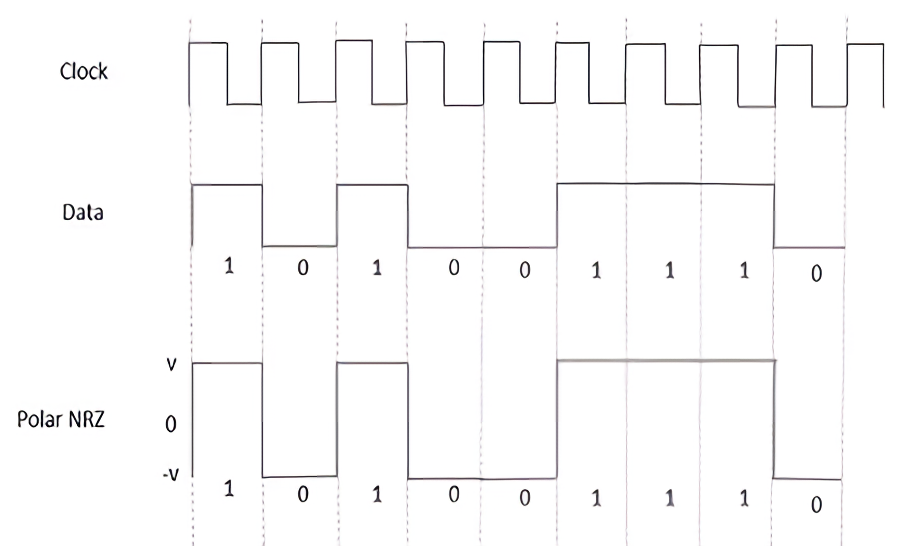

不归零编码有同步问题

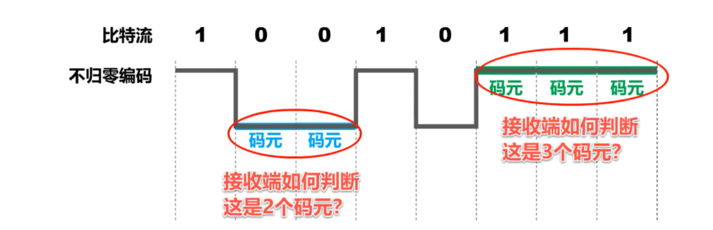

NRZI 根据上一个为基准 0则开头边缘翻转 1则开头边缘不翻转 

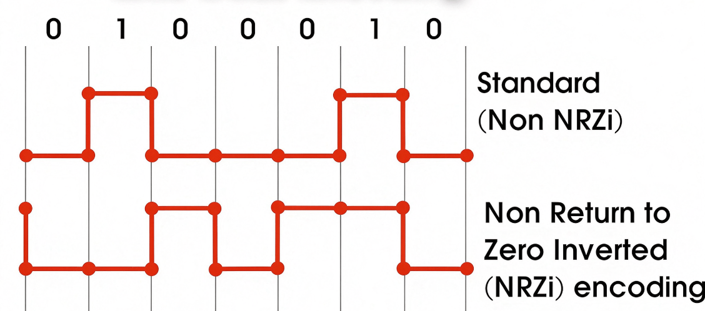

RZ 维持一半时间后归零 高正低负

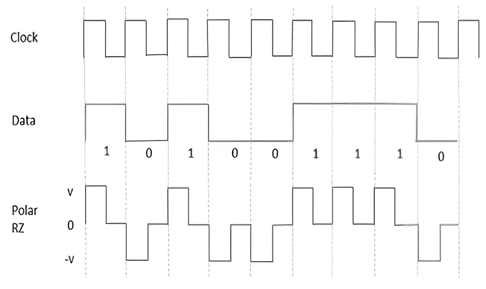

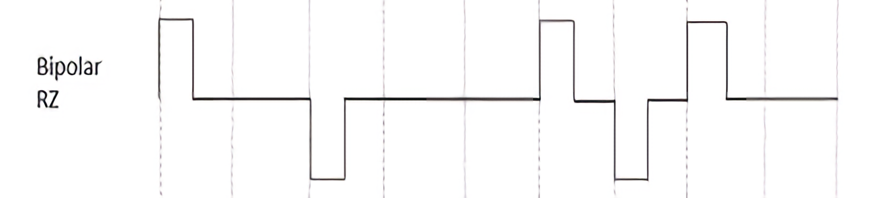

MC 中间跳变 1上跳 0下跳 或者1下跳 0上跳 没有唯一的标准

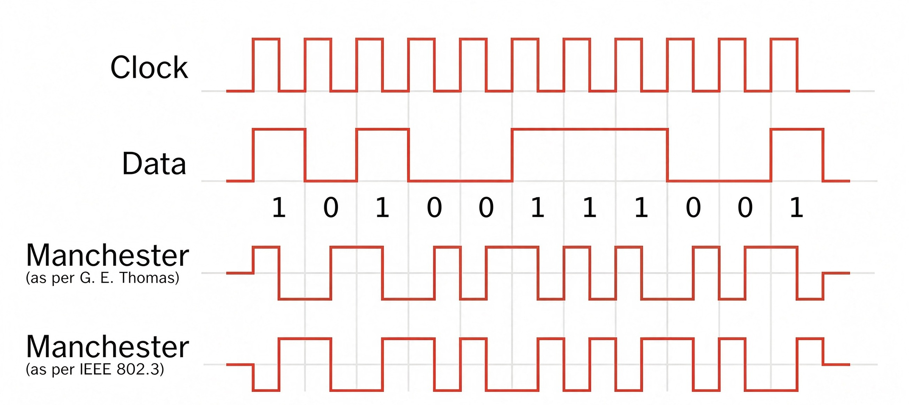

DMC 0则开头边缘跳变 1则开头边缘不跳变 

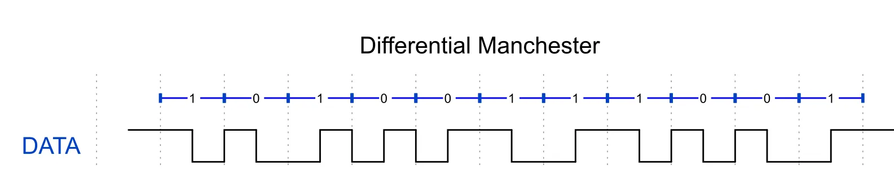

Biphase-M

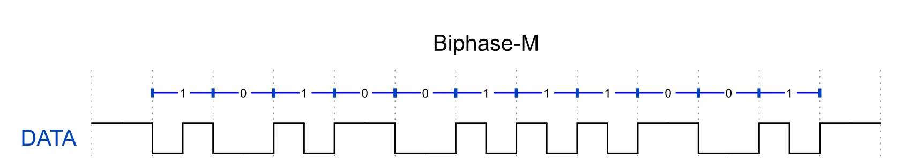

Biphase-S

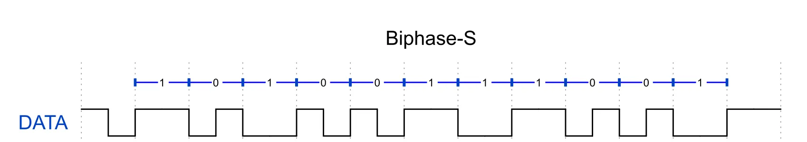

#### 数字带通调制：使用载波改变信号频率范围

amplitude-shift ASK 幅移键控

frequency-shift FSK 频移键控

phase-shift modulation PSK 相移键控

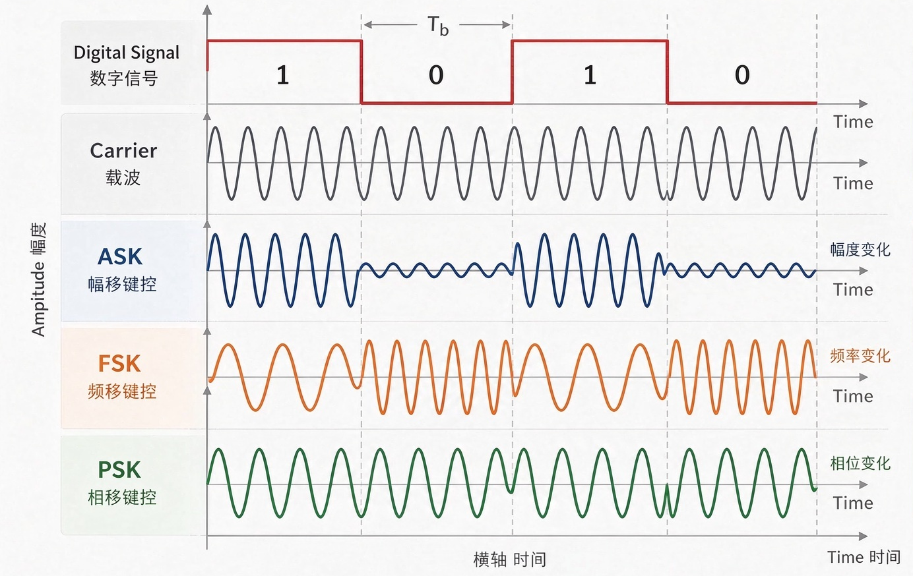

#### 混合调制

幅相混合：

QAM正交幅度调制  

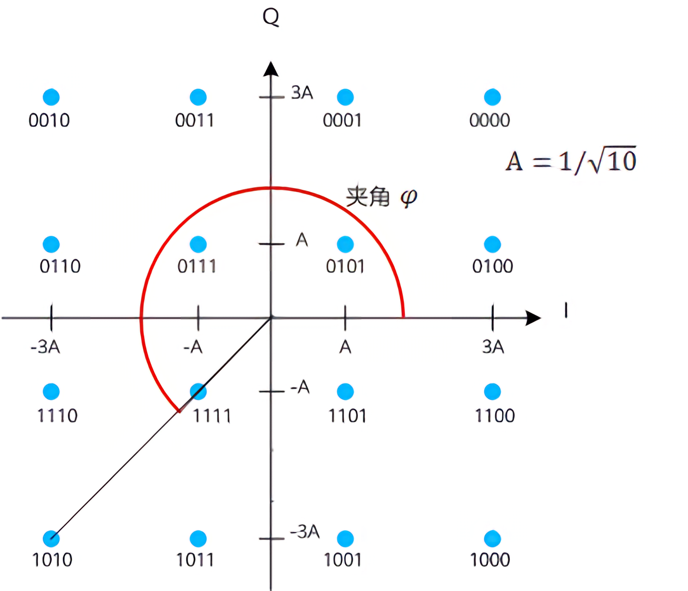

通过幅度和相位编码 相邻的码使用格雷码编码
QAM-16有16个码元 wifi使用的QAM-256有256个码元 

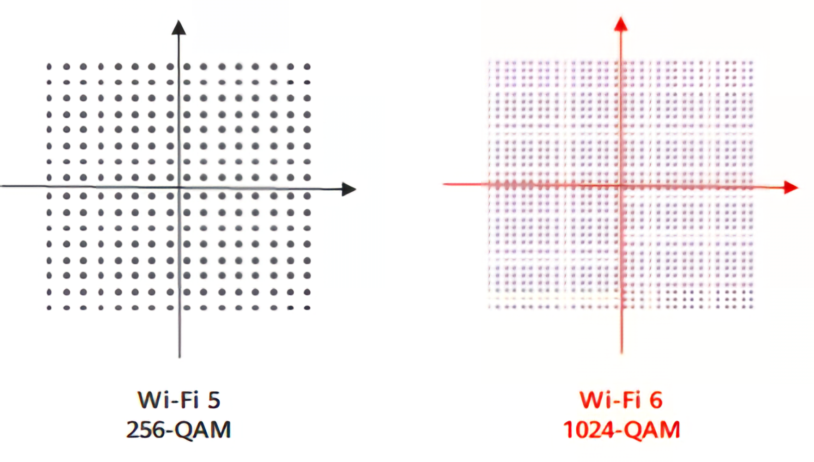

APSK幅相键控

频相混合：。。。

幅频混合：。。。

#### 传输速率

带宽 = 最高频率 − 最低频率

速度v = 频率f $\times$ 波长λ

奈奎斯特准则 ：带宽 $W$Hz 的无噪声/有噪声信道，每秒最多传 $2W$ 个符号

最大码元传输速率$B_{max}=2W(baud)$ 

香农定理 ：带宽 $W$Hz 的有噪声信道，一个符号携带的比特数最多是$\frac{1}{2}\log_2(1+\frac{S}{N})$

最大信道容量$C_{max}= B_{max} \times \frac{1}{2}\log_2(1+\frac{S}{N}) = W\log_2(1+\frac{S}{N})$

香农-奈奎斯特采样定理：采样频率不能低于信号最高频率的 2 倍

信噪比可以用分贝表示，$dB=10\log_{10}(\frac{S}{N})$

复用技术

在同一个波上复用

FDM: Frequency Division Multiplexing（频分复用）

每队用户独享一个频段

TDM: Time Division Multiplexing（时分复用）

每队用户独享一个时间片

STDM: Statistical Time Division Multiplexing（统计时分复用）

按需动态分配时间片

WDM: Wavelength Division Multiplexing（波分复用）

本质上是光的FDM

CDMA: Code Division Multiplex Access (码分多址)

发送0或1 如果编码序列长n 那么最多产生n个彼此正交的向量 用这些向量编码

假设发送消息

